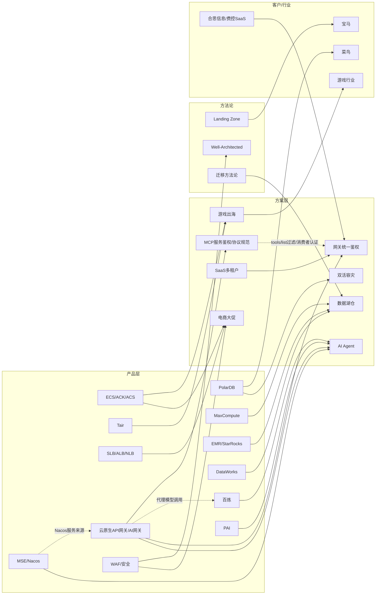

# Index — Wiki 内容目录

> **Karpathy LLM Wiki 核心导航文件**：The LLM reads the index first to find relevant pages, then drills into them.
> 本文件在每次 Ingest 后由 LLM 更新。按类目组织，每条含链接 + 一行摘要 + 来源数。

---

## 知识层（Knowledge — 动态，随蒸馏持续更新）

### 产品知识

| 页面 | 摘要 | 规模 |
|------|------|------|
| [knowledge/aliyun-products.md](knowledge/aliyun-products.md) | 67+ 产品能力卡（能力边界/选型场景/避坑/报价量级），含 13 行选型速查表 + 8 张决策树；**云原生 API 网关（APIG）/ AI 网关深度卡**（三形态谱系+原API网关EOL+网关外部认证 A/B 两路+service_name FQDN 规则+计费全表+**MCP 鉴权维度**（协议层事实/三种鉴权能力对照/HTTP转MCP 语义/引用限定）+**forward_auth 源码级细节**+产品缺口） | ~2380 行 |

### 场景方案

| 页面 | 摘要 | 规模 |
|------|------|------|
| [knowledge/cloud-solutions.md](knowledge/cloud-solutions.md) | 10 套高频场景方案（S1 电商大促 / S2 游戏出海 / S3 AI Agent / S4 双活 / S5 数据湖仓 / S6 视频 / S7 车联网 / S8 零售数据中台 / S9 SaaS 多租户 / **S10 客户自有认证接口接入网关统一鉴权**（含 2026-09 合思费控 SaaS/MCP 上架实战案例：A 路 404 根因 → forward_auth 零改动解法）），含升级阈值表 | ~1500 行 |

### 行业地图

| 页面 | 摘要 | 规模 |
|------|------|------|
| [knowledge/industry-landscape.md](knowledge/industry-landscape.md) | 7 张行业卡（互联网/金融/游戏/零售/教育/汽车/制造），含市场规模/痛点/合规/竞争格局 | ~470 行 |

### AI 趋势

| 页面 | 摘要 | 规模 |
|------|------|------|
| [knowledge/ai-trends.md](knowledge/ai-trends.md) | 百炼/PAI/通义/Qwen3.7 演进线，PD 分离实测数据，Agent 三层次模型，AI Infra 高可用模式，AIGC 内容生产矩阵 ，MaaS 商业模式分析，**Agent 知识工程**（LLM Wiki/Skillify/多对一编译/KBase实践 ），**长上下文/思考模型延迟治理**（GLM-5.2/max_completion_tokens/64K悬崖/RULER/ 客户端Playbook），**Coding Agent 工程化**（Loop/Graph Engineering 定谱、门禁>图谱优先级、A1-A5自主度矩阵、六方反对图编排、代码图谱轻量档、多仓库服务化、沙箱与凭据红线） | ~510 行 |

### 客户画像

| 页面 | 摘要 | 规模 |
|------|------|------|
| [knowledge/company-profiles.md](knowledge/company-profiles.md) | 9 旗舰客户深度档案（南京银行/哈啰/一汽/B 站/启迪公交/51Talk/菜鸟/心动/雅迪/**合思信息(原易快报)**）+ 200+ 国际客户索引 | ~430 行 |

### 竞品云情报

| 页面 | 摘要 | 规模 |
|------|------|------|
| [knowledge/competitor-cloud.md](knowledge/competitor-cloud.md) | AWS/Azure/GCP/腾讯/华为/火山引擎对位映射，AI 模型竞品矩阵（7 厂商 × 6 维），Winback 策略框架，游戏出海深度对比，**火山引擎 API 网关/AI 网关（MCP+外部认证）对标**（仅实例级/同私有网络硬约束反击点 + Envoy 底座同源结论 + 文档站 SPA 取数陷阱） | ~560 行 |

---

## 参考层（References — 静态框架，不随蒸馏变化）

| 页面 | 摘要 | 规模 |
|------|------|------|
| [references/well-architected.md](references/well-architected.md) | WAF 五大支柱 + 网络 WAD 七场景 + ACSG 六层纵深防御 | ~140 行 |
| [references/caf-landing-zone.md](references/caf-landing-zone.md) | CAF 六阶段 + 五大能力 + Landing Zone 六组件 | ~150 行 |
| [references/cloud-product-mapping.md](references/cloud-product-mapping.md) | 场景 × 产品矩阵速查（业务场景反查产品组合） | ~120 行 |
| [references/customer-playbook.md](references/customer-playbook.md) | 客户类型话术 + 决策时延层级（L1-L5） | ~100 行 |
| [references/architecture-templates.md](references/architecture-templates.md) | 高频架构模板（双活/出海/大数据/AIGC/Landing Zone/ADR） | ~310 行 |
| [references/migration-methodology.md](references/migration-methodology.md) | IDC→云迁移 4 阶段 + 6R 决策矩阵 + 工具链 + 风险清单 | ~380 行 |
| [references/bigdata-migration.md](references/bigdata-migration.md) | 大数据迁云专项（CDH→EMR/Hive→MC/Kafka/HDFS→OSS/Oracle→MC/Airflow→DataWorks） | ~510 行 |

---

## 管理层（Management）

| 文件 | 用途 |
|------|------|
| [knowledge/inbox.md](knowledge/inbox.md) | Raw 层注册入口 — 来源登记 + 状态机（pending→processing→done） |
| [changelog.md](changelog.md) | 时间线日志 — 每次 Ingest/Lint 的记录（等同 Karpathy 的 log.md） |
| [index.md](index.md) | 本文件 — Wiki 内容目录（等同 Karpathy 的 index.md） |

---

## 元层（Schema）

| 文件 | 用途 |
|------|------|
| [SKILL.md](SKILL.md) | 协议层 — 角色定义 + 工作模式 + 红线（等同 Karpathy 的 CLAUDE.md/AGENTS.md） |
| [README.md](README.md) | 设计说明 — 架构决策与演进路径 |

---

## 源层（Raw — 不可变原始资料）

| 目录 | 用途 | 当前状态 |
|------|------|----------|
| [raw/ata/](raw/ata/) | ATA 内部文章快照 | 13 篇已归档（11 篇全文 + 2026-09-21 两篇 ATA **摘录**（SSO 拦截无法取全文，头部已注明）） |
| [raw/aliyun-docs/](raw/aliyun-docs/) | help.aliyun.com 文档片段 | **25 篇全文已归档**（2026-09-21 网关外部认证专项 16 篇 + 收口补充 9 篇：MCP 文档 5 篇 + AI Credits/Serverless 计费补归档 3 篇 + llms.txt 索引）+ 2 篇 2026-06-17 占位 |
| [raw/customer-cases/](raw/customer-cases/) | 客户案例原始资料 | 待补充 |
| [raw/industry-reports/](raw/industry-reports/) | 行业报告、白皮书 | 待补充 |
| [raw/standards/](raw/standards/) | 开放标准/协议规范原文（2026-09-21 新建） | 4 篇已归档（MCP 官方规范 authorization 2026-07-28/2025-11-25 + transports/streamable-http 2026-07-28） |
| [raw/competitor/](raw/competitor/) | 竞品云公开资料 | **4 篇已归档**（2026-09-21 火山引擎 API 网关：MCP 服务/外部认证鉴权/安全与认证概述/什么是 API 网关，经 getDocDetail API 取 MDContent） |
| [raw/misc/](raw/misc/) | 其他来源 | 1 篇已归档（Higress ext-auth main.go/config.go **源码摘录**，注明非全文） |

---

## 实体关系图（Mermaid）

---

## 交叉引用快查

以下为高频实体的跨文件出现位置：

| 实体 | 出现位置 |
|------|----------|
| PolarDB | aliyun-products / cloud-solutions(S4) / company-profiles(启迪/菜鸟) / competitor-cloud / bigdata-migration |
| 百炼 | aliyun-products / cloud-solutions(S3) / ai-trends / competitor-cloud(火山引擎) |
| **Loop Engineering** | **ai-trends(第11.1节 术语定谱、飞樰六大框架、釋心 Go-Drive-Harness-Tracker-Gate 五要素)** |
| **Graph Engineering** | **ai-trends(第11.1节 Loops watching loops + 三护栏、第11.7节 六方反对图编排、第11.8节 代码图谱轻量档)** |
| **Coding Agent 服务化** | **ai-trends(第11.9节 三种形态+合规红线、第11.10节 Devin/Cursor/Stripe 多仓架构)** |
| **Multica** | **ai-trends(第11.9节 本地Daemon+云端编排形态)**；完整源码测绘在项目 `loop_engineering_practice/research/findings/multica.md` |
| ACK/ACS | aliyun-products / cloud-solutions(S2游戏) / architecture-templates / competitor-cloud |
| Landing Zone | caf-landing-zone / architecture-templates / company-profiles(宝马) |
| MaxCompute | aliyun-products / bigdata-migration / cloud-solutions(S5) |
| 出海 | cloud-solutions(S2) / competitor-cloud / industry-landscape(游戏) / architecture-templates |
| WAF/安全 | aliyun-products(安全域9产品) / well-architected(ACSG) / cloud-solutions(全场景安全章节) |
| Tair | aliyun-products / cloud-solutions(S2游戏) / competitor-cloud(ElastiCache对比) |
| 迁移 | migration-methodology / bigdata-migration / competitor-cloud(Winback) / aliyun-products(DataX) |
| DataWorks | aliyun-products / bigdata-migration(ETL调度) / cloud-solutions(S5数据湖仓) |
| EMR | aliyun-products / bigdata-migration(CDH→EMR) / cloud-solutions(S5) |
| EMR Serverless StarRocks | aliyun-products(独立深度卡) / cloud-solutions(S5湖仓加速层) / bigdata-migration(Impala→StarRocks) |
| Qwen/通义 | aliyun-products(AI域) / ai-trends(演进线) / competitor-cloud(模型矩阵) |
| SLB(CLB/ALB/NLB) | aliyun-products(网络域) / cloud-solutions(全场景负载均衡) / architecture-templates |
| MSE/Nacos | aliyun-products(中间件域，含四版本矩阵；卡内「云原生网关」条目已加与 APIG 的名称消歧) / cloud-product-mapping(微服务化中型业务) / cloud-solutions(S3 AI Agent 注册发现、S10 Nacos 服务来源) |
| **云原生API网关（APIG）/ AI网关** | **aliyun-products(接入/网关补充 深度卡：三形态谱系+原API网关EOL+外部认证A/B两路+FQDN命名+计费全表；原 API Gateway 卡已标 EOL) / cloud-solutions(S3 AI Gateway 口径与成本订正、S10 统一鉴权方案) / ai-trends(高可用AI系统 口径注) / architecture-templates(T8 口径注)** |
| **网关外部认证（ext-auth/service_name）** | **aliyun-products(A路全局认证鉴权字段表 + B路 ext-auth 全字段表 + service_name FQDN 四种命名 + 超时单位陷阱 + forward_auth 源码级细节/产品缺口) / cloud-solutions(S10 A/B 决策树+配置骨架+2026-09 合思实战案例)** |
| **MCP 鉴权（tools/list/消费者认证/传输层鉴权）** | **aliyun-products(深度卡「MCP 维度」节：协议层事实[规范]/三种鉴权能力对照表/HTTP转MCP 语义/官方 debug 反证/引用限定) / cloud-solutions(S10 实战案例 MCP 特有维度) / competitor-cloud(火山 MCP 服务对标)** |
| **火山引擎 API 网关/AI 网关对标** | **competitor-cloud(外部认证插件对位表/仅实例级+同私有网络两反击点/Envoy 底座同源/文档站 SPA 取数陷阱) / aliyun-products(MCP 维度火山侧同构事实)** |
| **合思信息（原易快报）** | **company-profiles(深度画像：费控 SaaS+千问办公 MCP 上架+SA 归属链) / cloud-solutions(S10 实战案例客户)** |

| 灵骏/Lingjun | ai-trends(PAI GPU定价) / aliyun-products(PAI产品卡) |

---

*最后更新：2026-09-21（第二轮收口补充）— MCP 鉴权维度 + 火山引擎 API 网关对标 + 合思客户画像 + ext-auth forward_auth 源码取证 + 引用限定修正：raw 新增 20 篇（aliyun-docs 补归档 9 + standards 新目录 4 + competitor 4 + misc 源码摘录 1 + ata 摘录 2）；aliyun-products 深度卡补 MCP 维度/forward_auth 细节/产品缺口（+107 行）；cloud-solutions S10 补实战案例；competitor-cloud 补火山网关对标（+41 行）；company-profiles 补合思（+35 行）；回归用例 v1.4（GW05/GW06），32/32 PASS + 负控两套基线全 FAIL 证明非假绿。首轮记录：云原生API网关/AI网关 深度蒸馏（外部认证专项，16 篇 raw），回归 v1.3（T10 扩词 + GW01-GW04）*
