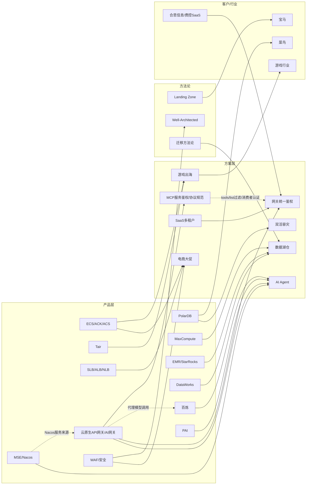

# Index — Wiki 内容目录

> **Karpathy LLM Wiki 核心导航文件**：The LLM reads the index first to find relevant pages, then drills into them.
> 本文件在每次 Ingest 后由 LLM 更新。按类目组织，每条含链接 + 一行摘要 + 来源数。

---

## 知识层（Knowledge — 动态，随蒸馏持续更新）

### 产品知识

| 页面 | 摘要 | 规模 |
|------|------|------|
| [knowledge/aliyun-products.md](knowledge/aliyun-products.md) | 72+ 产品能力卡（含 Meoo 独立卡 for Vibe Coding + ClickHouse 企业版/社区兼容版双线卡 + **文档智能 DocMind 卡** + **网络域 ENI 弹性网卡 / EIP 弹性公网 IP 双独立卡** + **向量检索/RAG 检索引擎选型节（12 条产品线）**），15 行选型速查表 + 9 张决策树；百炼卡含「知识库（RAG）完整规格与计费」、PAI 卡含「EAS 独享 GPU 报价与私有化部署路线约束」+ 🔴「灵骏智算 GPU 卡型 × 实例规格全表」[内部] + 🔴「灵骏两套体系关系 + ×1.10 溢价定律」[内部]；**云原生 API 网关（APIG）/ AI 网关深度卡**（三形态谱系+原API网关EOL+网关外部认证 A/B 两路+service_name FQDN 规则+计费全表+**MCP 鉴权维度**（协议层事实/三种鉴权能力对照/HTTP转MCP 语义/引用限定）+**forward_auth 源码级细节**+产品缺口） | **~3400 行 ⚠️ 已超 2500 行拆分阈值（AGENTS.md），待拆分** |
| [knowledge/aliyun-lingjun-bms.md](knowledge/aliyun-lingjun-bms.md) | 🔴 **[内部·严禁对客，唯 §14 例外可对客]** 灵骏裸金属（`bccluster`）专题页：商品 code / **PAI↔裸金属 ×1.10 溢价定律** / 卡型代号↔芯片映射（新增 L20P·PPU810）/ **六档固费分期折扣阶梯（H20 系为唯一例外）** / 19 地域月单价速查 / 行业云溢价 ×1.90–2.00 / 2026-04-18 调价清单 266 条 / 逐机型硬件规格与 HPN 网络世代 / 四级加白标签体系 / 超节点与 AmazingPod / 系统盘计费红线 / 开通与退订实操 / 源表数据质量问题 / 11 条 SA 报价速查（**第 11 条已勘误：灵骏并非"无公开 SLA"，而是 SLA 无可用率百分比**）/ ✅ **§14「灵骏 vs ECS 裸金属：本质区别与选型判据」（全官方公开源，可对客）**：五维对比表 / 网络对象模型分岔（VPD·NCD·灵骏连接 4×VBR vs VPC·eRDMA·SCC 800G+NVSwitch）/ 换机不修机的运维模型 / CPFS 智算版官方不支持 ECS 直挂 / 三份 SLA 对照 / 6 条选型判据（含白皮书 **>100 卡**唯一官方阈值） | ~955 行 |
| [knowledge/olap-engine-selection.md](knowledge/olap-engine-selection.md) | **六引擎 OLAP 场景选型专题**（ADB/Hologres/Doris/SelectDB/StarRocks/ClickHouse，2026-08-21 深度调研 7 路 subagent 三源交叉验证）：一句话定位速查 + 场景→引擎映射表 + **[共识]可信清单**（ClickBench 实解析 CK 18.1s 单表登顶/CK 四短板连对手都承认/Doris≈SR 同源无代差）+ **[厂商]存疑清单**（14 倍/登顶/6 倍等 6 条勿对客引用）+ 关键版本门槛表（存算分离/JSON/向量/AI 函数）+ 阿里云售卖映射与内部实战口径[内部] + 商业公司变动信号（CelerData→PhoenixAI）+ 报价提醒锚链 | ~1347 行 |
| [knowledge/geospatial-products.md](knowledge/geospatial-products.md) | **时空/GIS（GEO）能力地图专题**（2026-08-25 Query 回写，4 路 subagent 官方文档核验）：阿里云无独立 LBS 产品，时空能力=**GanosBase 引擎**（PolarDB PG 免费自带/RDS PG/ADB PG 不单独计费但 Serverless 不支持）+ **Lindorm Ganos 时空服务**（宽表组件，Z-ORDER/S2/xz2t 索引，GeoMesa 兼容，仅收宽表费）+ 轻量 LBS（**TairGIS 仅企业版内存型**/Tablestore geo 三查询/ES geo_point·geo_shape）+ 大数据（EMR Sedona/MaxCompute Hive GIS UDF）+ DataV 时空可视化 + 高德开放平台（独立非阿里云产品）；含 Ganos 三分法选型、场景×产品速查、**9 条避坑红线**（IoT 设备位置服务停新开通/HBase Ganos 下线/坐标纬度在前等） | ~1237 行 |
| [knowledge/lbs-application-chain.md](knowledge/lbs-application-chain.md) | **LBS 应用全链路架构专题（美团/饿了么级参考）**（2026-08-25 Query 回写，4 路 subagent：公开博客+ATA 50+ 篇[内部]+产品核验+坑点）：端侧定位→上报→纠偏→时空索引→逆地理→地址治理七环节业界做法；**Redis GEO 非必须**（美团 Solr+GeoHash/滴滴 MongoDB/Uber H3/蜂鸟 H3→AOI/淘点点 PostGIS）；**菜鸟地址库对外不可用**[内部]，对外=高德逆地理（个人 5000 次/日·企业 300 万/日·商用许可 5-10 万/年）+阿里云地址标准化 MGeo；geohash 格子缓存降 90% 调用量；**9 条坑清单**（坐标系/抖动/POI≠收货点/POI 年变更 40%/区划版本卡单/后台定位 OS 硬限制/轨迹合规）；三阶段落地路径 | ~1409 行 |
| [knowledge/aliyun-agentcore.md](knowledge/aliyun-agentcore.md) | 🔴 **AgentCore（智能体构建和治理平台）专题页**（蒸馏 2026-09-21 / 源抓取 2026-09-20；help.aliyun.com 官方 `.md` Agent 通道 + terms.alicdn.com SLA 协议全文；13 节 §0~§12，§0 定位与按角色阅读路径）：**官方定位逐字**＝「以**构建与运行、协作与治理、观测与评估**三大能力覆盖 **Agent 全生命周期**，将**自研 / 开源 Harness / 商业 SaaS Agent 多来源统管于一个平台**」；🔴 **§1 三个平级产品辨析（不是父子）**＝**AgentCore `3052261` 现役主产品**（§2~§8 全覆盖）/ **AgentTeams `3034770` 已迁移至 AgentCore**（遗留文档，仅 §9 作迁移对照：不自动迁移 / 5 类不迁移项 / 术语映射仅 1 条有证据）/ **AgentRun `3049178` 独立托管运行时、本页未蒸馏**（317 页，建议单独排期）；🔴 **§1.1「AgentTeams」一名两指**＝已迁移的独立产品 vs AgentCore **现役**的「协作客户端 (WEB)」，对客必须显式消歧（N3）；**§2 资源对象模型**（一切以 Workspace 为界）+ **§3 三种 Agent 形态与部署路径**（模板 / 高代码 / **本地纳管 Agent**）；🔴 **§4 计费骨架 5 项**＝算力 CU **0.0000694** / 网关 CU **0.0000015** / 存储 CU **0.00025** 元/CU（1 GB 内存·秒=0.5 CU）+ 协作专享管控面 **3 元/小时 ≈ 2160 元/月**（可选、开着就烧）+ 公网流量 **0.8 元/GB**（🔴 **由 CDT 统一计费出账、不在 AgentCore 账单里**）；**北京/杭州/上海/深圳四地完全同价**；🔴 **新加坡单价官方未公开，禁用内地价外推**；**§4.5 依赖产品 3 项（CMS 云监控 / PrivateLink / SchedulerX3）→ 账单 ≠ 全成本**；🔴 **§7 SLA**＝**Agent 运行时服务可用性 99.9%**（2026-09-18 生效，未达标 3 档 **15%/30%/100%** 服务代金券、服务单元=Workspace、跨 Workspace 可叠加）+ **两条必说限定词**＝① 承诺**仅覆盖平台自身 Agent 运行时**（客户自研/纳管的 Agent 自身可用性不在内）② **整份协议不适用于公测/邀测/免费功能及本地云版本**；🔴 **强时效**＝协作管控面**限免 2026-09-18 ~ 2026-10-18**，官方逐字「**活动结束后计费策略另行通知**」→ 2026-10-19 起不得沿用限免口径报价（§11.5 复核清单）；限免期实例**连续 30 天无操作即停用并不可逆回收**；🔴 **对客红线关键词**＝钉钉/飞书账号集成**最多 30 个用户、超出即失败**；**无微信账号集成**（企业微信只是消息通道，N2）；**无 LDAP/SCIM/RAM 目录同步**（需另配 IDaaS，KB 内暂无该卡）；「**本地纳管 Agent**」**不是 NanoAgent**（NanoAgent 只存在于 slug）；RAM 控制台要搜 `Magic` 而非 AgentCore；**§10 SA 视角：选型判据 + 对客红线 12 条（R1~R12）+ 实操避坑 + 报价速查** / **§11 缺口与官方矛盾总登记（矛盾 N1~N11 + 报价三硬缺口 P-SG·P-DP·P-CU + 未商用能力 4 项 + 缺口跨 7 节索引：§2.4 11 类 / §4.9 P1~P9 / §5 10 条 / §6.6 S1~S7 / §7.8 GA1~GA16 / §8.6 GS1~GS8 / §9.11 GT1~GT14）** / **§12 源清单与溯源（§12.1 页数口径唯一权威定义 + §12.2 软 200 抓取陷阱方法沉淀 + §12.3 三路差集覆盖率到顶声明 + §12.5 更正留痕 D1~D7）** | **1823 行 / 86 张表 / 51 个 raw 快照 / [官方] 287 · [推断] 49 · [官方矛盾] 17**（grep 全文命中，含页首证据标注图例各 1 处） |
| [knowledge/aliyun-ai-gateway.md](knowledge/aliyun-ai-gateway.md) **+ 6 个子页** | 🔴 **AI 网关（AI Gateway）专题页家族**（抓取 + 蒸馏均 2026-09-21；help.aliyun.com 官方 `.md` Agent 通道 189 页 + terms.alicdn.com SLA 协议全文；7 路并行蒸馏 worker + 主控装配）：**定位**＝云原生 API 网关面向 AI 原生应用的托管入口，统一代理百炼/OpenAI/Anthropic/Bedrock/Azure 及 vLLM/SGLang 自建模型、**兼容 OpenAI 协议**、**Model API / Agent API / MCP Server 三类接入**；🔴 **归属辨析**＝API 网关产品族**三个平级子产品之一**（云原生API网关 / AI 网关 / 原API网关，后者 2026-08-23 停新购、2027-09-21 下线）；**主页 §15 SA 速查卡**含 4 形态选型（Serverless 标准版 **0 元起步** / 企业版 **0.245 元/小时** / 旧版 **0.005 元/千CU** · CU 系数 **Model 10·MCP 5·Agent 2** / 专享 `aigw.small.x1` **7.9335 元/小时**、**金融云 ×1.9**、最高 **192,000 QPS**）+ 🔴 **三本账**（网关 + **AI Credits 独立商品 0.01 元/Credit** + 模型服务）+ **六类连带**（CDT/SLS/云监控/KMS/AI安全护栏）；🔴 **§14 实战避坑**＝**SLA「无赔偿区」[99.90%, 99.95%)**（协议只承诺 serverless ≥99.90%、普通 ≥99.99%，产品页却宣称 99.95%，赔偿仅限代金券）/ **自建认证 404 是设计行为**（真实 Path = 鉴权API+原始Path、鉴权 API **需前缀匹配**、且 **404 不在宽松模式兜底范围**，解法 ext-auth `forward_auth`）/ **Fallback 默认在限流命中时也触发** / **私网数据处理量 0.049 > 公网 0.037** / **多租户无法靠 RAM 资源级授权**（SLR `Resource` 全为 `*`、66/140 Action 标「全部资源」、MCP·模型元信息·消费者组·插件**无 ARN 定义**）/ **提额＝弃 SLA** / **slug↔插件名交叉错位**（`ai-cue-template` 实为 ai-prompt-decorator）/ **`ai_log.safechack_status` 错字必须照抄**；**§0 溯源**含 🔴 **五种抓取失效模式**（软 200 24893B / CT 不符 / 空 body / **Document Not Found 86B 桩**〔本次新发现〕/ **服务端静默截断**〔本次新发现，`agent-api-observable` 978B 断在孤立 `*`〕）+ 覆盖率审计（378 个 docId 双形态解析、命中 358、死链 0）+ **驳回 2 条 worker 假警报** | **主页 1413 行 + 6 子页 = 9471 行 / 411 张表 / 186 个 raw 快照 / `[官方｜slug]` 290 · `[官方原文]` 49 · `[官方矛盾]` 99 · `[文档未说明]` 550 · `[推断]` 201 · `[原文如此]` 49** |
| ↳ [-billing](knowledge/aliyun-ai-gateway-billing.md) / [-traffic](knowledge/aliyun-ai-gateway-traffic.md) / [-auth](knowledge/aliyun-ai-gateway-auth.md) / [-mcp-agent](knowledge/aliyun-ai-gateway-mcp-agent.md) / [-plugins](knowledge/aliyun-ai-gateway-plugins.md) / [-ops](knowledge/aliyun-ai-gateway-ops.md) | §3 计费与商务（含 §3.9 SLA 与赔偿）963 行 ｜ §4 核心对象模型 + §5 流量治理与成本控制1347 行 ｜ §6 鉴权与消费者体系 + §7 AI 安全护栏与 RAM1247 行 ｜ §8 MCP 与 Agent API 生态1411 行 ｜ §9 插件体系1541 行 ｜ §10 可观测与运维 + §11 门户与开放平台 + §12 实践教程 + §13 OpenAPI 与 RAM 元信息1549 行 | 扁平 7 文件（不建子目录，与既有 `knowledge/` 同形；裁决 R3） |

### 场景方案

| 页面 | 摘要 | 规模 |
|------|------|------|
| [knowledge/cloud-solutions.md](knowledge/cloud-solutions.md) | **11 套**高频场景方案（S1 电商大促 / S2 游戏出海 / S3 AI Agent / S4 双活 / S5 数据湖仓 / S6 视频 / S7 车联网 / S8 零售数据中台 / S9 SaaS 多租户 / **S10 企业内部知识库（员工侧 RAG）** / **S11 客户自有认证接口接入网关统一鉴权**（含 2026-09 合思费控 SaaS / MCP 上架实战案例：A 路 404 根因 → forward_auth 零改动解法）），含升级阈值表 | ~1700 行 |

### 行业地图

| 页面 | 摘要 | 规模 |
|------|------|------|
| [knowledge/industry-landscape.md](knowledge/industry-landscape.md) | 7 张行业卡（互联网/金融/游戏/零售/教育/汽车/制造），含市场规模/痛点/合规/竞争格局；**制造卡新增「制造业 AI 落地专项」**（渗透现状/光伏组件三梯队场景优先级/能力底座建设顺序/组织侧蒸馏焦虑/可对标案例清单） | ~500 行 |

### AI 趋势

| 页面 | 摘要 | 规模 |
|------|------|------|
| [knowledge/ai-trends.md](knowledge/ai-trends.md) | 百炼/PAI/通义/Qwen3.7 演进线，PD 分离实测数据，Agent 三层次模型，AI Infra 高可用模式，AIGC 内容生产矩阵，MaaS 商业模式分析，**Agent 知识工程**（LLM Wiki/Skillify/多对一编译/KBase实践），**Meoo Vibe Coding 分支**，**第10节 企业级 AI 战略与落地路径 2026 共识**（架构选型三阈值/评测方法论/L1-L3 度量模型/组织设计双模板/8 条面客避坑/云知道第三方报告索引），**第11节 商业化 Agent 工作台形态参考 Accio Work**（四件套架构/Credits 定价/企业版治理模型/生态接入/6 条 SA 复用洞察），**第12节 Agent 工程问答速查**（skill 治理/harness 落地/3-5 年趋势/RAG vs 本体/记忆与协议/闭环自增强/MiniMax vs DeepSeek），**第13节 长上下文/思考模型延迟治理**（GLM-5.2/max_completion_tokens/64K 悬崖核查/RULER/客户端 Playbook），**第14节 Coding Agent 工程化**（Loop/Graph Engineering 定谱、门禁>图谱优先级、A1-A5 自主度矩阵、六方反对图编排、代码图谱轻量档、多仓库服务化、沙箱与凭据红线） | ~665 行 |

### 客户画像

| 页面 | 摘要 | 规模 |
|------|------|------|
| [knowledge/company-profiles.md](knowledge/company-profiles.md) | 9 旗舰客户深度档案（南京银行/哈啰/一汽/B 站/启迪公交/51Talk/菜鸟/心动/雅迪/**合思信息(原易快报)**）+ 200+ 国际客户索引 | ~430 行 |

### 竞品云情报

| 页面 | 摘要 | 规模 |
|------|------|------|
| [knowledge/competitor-cloud.md](knowledge/competitor-cloud.md) | AWS/Azure/GCP/腾讯/华为/火山引擎对位映射，AI 模型竞品矩阵（7 厂商 × 6 维），Winback 策略框架，游戏出海深度对比，**火山引擎 API 网关/AI 网关（MCP+外部认证）对标**（仅实例级/同私有网络硬约束反击点 + Envoy 底座同源结论 + 文档站 SPA 取数陷阱） | ~560 行 |

### 运维与服务

| 页面 | 摘要 | 规模 |
|------|------|------|
| [knowledge/service-availability.md](knowledge/service-availability.md) | **服务可用性与 SLA 对客交付四层速查**（SLA 协议汇总页/健康看板 status.aliyun.com/顶级支持计划服务报告/云监控自建度量 + 赔偿流程 + SA 澄清话术） | ~70 行 |

---

## 参考层（References — 静态框架，不随蒸馏变化）

| 页面 | 摘要 | 规模 |
|------|------|------|
| [references/well-architected.md](references/well-architected.md) | WAF 五大支柱 + 网络 WAD 七场景 + ACSG 六层纵深防御 | ~140 行 |
| [references/caf-landing-zone.md](references/caf-landing-zone.md) | CAF 六阶段 + 五大能力 + Landing Zone 六组件 | ~150 行 |
| [references/cloud-product-mapping.md](references/cloud-product-mapping.md) | 场景 × 产品矩阵速查（业务场景反查产品组合） | ~120 行 |
| [references/customer-playbook.md](references/customer-playbook.md) | 客户类型话术 + 决策时延层级（L1-L5） | ~100 行 |
| [references/architecture-templates.md](references/architecture-templates.md) | 高频架构模板（双活/出海/大数据/AIGC/Landing Zone/ADR + **T11 大流量公网突破架构**：单点上限速查+三层手段+迅雷/出海实战[内部]） | ~340 行 |
| [references/migration-methodology.md](references/migration-methodology.md) | IDC→云迁移 4 阶段 + 6R 决策矩阵 + 工具链 + 风险清单 | ~380 行 |
| [references/bigdata-migration.md](references/bigdata-migration.md) | 大数据迁云专项（CDH→EMR/Hive→MC/Kafka/HDFS→OSS/Oracle→MC/Airflow→DataWorks） | ~510 行 |
| [references/pricing-verification-checklist.md](references/pricing-verification-checklist.md) | **报价前采购路径核验清单 v3**：**14 条硬门禁**（C1-C10 基础 + C11 版本可售性时效 + C12 Serverless 语义粒度 + **C13 Serverless 最低门槛费** + **C14 计费口径的计量基数**）+ **8 个实战反面案例**（CK 企业版/Hologres 网关/ADB 3 节点步长/RDS SQL Server Serverless 下线/PolarDB Serverless 不支持转包月/Flink 工作空间才停计费/**ES Serverless 最低门槛费**/**百炼 Rerank 计量基数低估 5 倍**）+ § 3.1 全域速查表 v2（30+ DB/大数据/AI/存储产品）+ **§ 3.1b 向量检索/RAG/文档解析增补 10 行** + § 3.2 红色预警清单（**24 条**已下线/无法新购/不可转包月/有硬顶 SKU）+ § 3.3 匿名核验边界（common-buy 全登录墙 + **6 类**必须登录复验/工单确认字段） | ~330 行 |

---

## 管理层（Management）

| 文件 | 用途 |
|------|------|
| [knowledge/inbox.md](knowledge/inbox.md) | Raw 层注册入口 — 来源登记 + 状态机（pending→processing→done） |
| [changelog.md](changelog.md) | 时间线日志 — 每次 Ingest/Lint 的记录（等同 Karpathy 的 log.md） |
| [index.md](index.md) | 本文件 — Wiki 内容目录（等同 Karpathy 的 index.md） |

---

## 元层（Schema）

| 文件 | 用途 |
|------|------|
| [SKILL.md](SKILL.md) | 协议层 — 角色定义 + 工作模式 + 红线（等同 Karpathy 的 CLAUDE.md/AGENTS.md） |
| [README.md](README.md) | 设计说明 — 架构决策与演进路径 |

---

## 源层（Raw — 不可变原始资料）

| 目录 | 用途 | 当前状态 |
|------|------|----------|
| [raw/ata/](raw/ata/) | ATA 内部文章快照 | **13 篇已归档**（11 篇全文 2026-06-17/06-28 + 2026-09-21 两篇 **摘录**，SSO 拦截无法取全文、头部已注明） |
| [raw/aliyun-docs/](raw/aliyun-docs/) | help.aliyun.com / docs.meoo.com / acciowork.yuque.com 文档片段 | **335 个文件 = 根层 27 篇 + 五个子目录 308 个**。根层：**25 篇 2026-09-21 网关外部认证专项全文**（统一仓库侧归档）+ 2 篇 2026-06-17 占位；子目录：**meoo/ 36**（34 篇 Meoo 官方文档，2026-07-07）+ **accio/ 29**（28 篇 Accio Work 知识库全站，2026-08-10）+ 🔴 **[agentcore/](raw/aliyun-docs/agentcore/) 35**（33 个正文快照，2026-09-20 抓取：32 个帮助中心页 + 1 个 SLA 协议全文来自 terms.alicdn.com）+ **[agentteams/](raw/aliyun-docs/agentteams/) 20**（18 个遗留页快照，2026-09-20），两目录各含 `README.md`（目录树映射 / 迁移横幅）与 `SHA256SUMS.txt`（33 条 / 18 条）+ 🔴 **[ai-gateway/](raw/aliyun-docs/ai-gateway/) 188**（186 个快照，2026-09-21 抓取：185 个 help.aliyun.com 页〔148 有正文含 1 个 OK-STUB 入口桩 + 37 个 TOC 容器〕+ 1 个 terms.alicdn.com SLA 协议全文），含 `README.md`（目录树映射 / **五种抓取失效模式** / 重复别名 / migration_status 判定 / 「不构成全站」边界声明）与 `SHA256SUMS.txt`（185 条，SLA 外部源不在内）；均含 SHA256；🔴 **SHA256 只对剥离 frontmatter 后的正文计算**，`shasum -c` 会全报 FAILED 属设计使然，正确校验 `tail -n +11 <file>.md \| shasum -a 256` |
| [raw/customer-cases/](raw/customer-cases/) | 客户案例原始资料 | **1 篇已归档**（2026-08-28 美偲 50TB/天视频拉取×EIP 选型会议听记，含 SHA256，🔴 含客户名仅限内部） |
| [raw/industry-reports/](raw/industry-reports/) | 行业报告、白皮书 | 待补充 |
| [raw/standards/](raw/standards/) | 开放标准/协议规范原文（2026-09-21 新建） | **4 篇已归档**（MCP 官方规范 authorization 2026-07-28 / 2025-11-25 + transports/streamable-http 2026-07-28） |
| [raw/competitor/](raw/competitor/) | 竞品云公开资料 | **4 篇已归档**（2026-09-21 火山引擎 API 网关：MCP 服务/外部认证鉴权/安全与认证概述/什么是 API 网关，经 getDocDetail API 取 MDContent） |
| [raw/misc/](raw/misc/) | 其他来源 | **9 篇已归档**（百炼增速/突发限流 2026-07-16；🔴 PAI 灵骏 GPU 卡型×实例规格全表 2026-08-10；🔴 灵骏裸金属 code×规格×列表价 2026-08-11；🔴 灵骏 20260418 涨价清单 266 条 2026-08-11；🔴 灵骏裸金属开通及退订方法 2026-08-11（后四篇 **Alibaba Internal，严禁对客**）；🔴 合思案 3 篇 practice-2026-09-21-hesi-*（internal-decision **勿外发**）；Higress ext-auth main.go/config.go **源码摘录** 2026-09-21，注明非全文；均含 SHA256） |

---

## 实体关系图（Mermaid）

---

## 交叉引用快查

以下为高频实体的跨文件出现位置：

| 实体 | 出现位置 |
|------|----------|
| PolarDB | aliyun-products / cloud-solutions(S4) / company-profiles(启迪/菜鸟) / competitor-cloud / bigdata-migration |
| 百炼 | aliyun-products(产品卡含增速/突发限流机制 + Token Plan + **知识库(RAG)完整规格与计费** + **Responses API 内置工具与工具调用价格** + **模型监控指标口径/收包耗时高延迟排查**) / cloud-solutions(S3, **S10**) / ai-trends / competitor-cloud(火山引擎) / raw/misc(限流机制内部文档) |
| **fun-asr / 录音文件识别 × OSS 内网免流量** | aliyun-products(百炼卡「语音模型文件输入（fun-asr / Paraformer 系录音文件识别）× OSS 流量费」节：fun-asr 部署于百炼 VPC，服务地域以 PrivateLink 文档为准=**北京/新加坡（大陆站=北京）**，bucket 在北京才免流量费【2026-08-25 当日勘误：初版误用 ISI 上海/北京/深圳口径已撤销】+ oss:// 临时 URL 与 OssResourceResolve 生产不推荐) / aliyun-products(OSS 卡流量费用速查③内网流出免费) |
| **OSS 存储计费规则 / 短生命周期存储选型** | aliyun-products(OSS 卡「存储计费规则速查」[2026-08-26]：五档 LRS 单价含深度冷归档 0.0075 / 最低存储时长起算点=低频·归档从 LastModified、冷归档·深度冷归档从转换时间 / 取回费 / 解冻时延 / 64KB / 请求费 + 30 天生命周期选型结论：冷归档纯成本判死、归档赢在回读率<≈38%、深度冷归档仅零回读+容忍天级取回) |
| **非实时 ASR 三模型对比 / fun-asr vs qwen-audio-3.0-asr-flash(-filetrans)** | aliyun-products(百炼卡「非实时 ASR 三模型对比」节[2026-08-26]：三者同价 0.00022 元/秒·北京、同限流 600 RPM、同 30 语种+七大方言；谱系 Paraformer→Fun-ASR→Qwen-Audio-3.0「百聆」，官方定位 Qwen-Audio-3.0 系为 fun-asr 升级替代；🔴 勿混 qwen3-asr-flash 系【独有情感识别但无热词/分离、仅 100 RPM】；fun-asr=长音频异步+预编译热词+说话人分离、无 Context，filetrans=同规格异步+即时热词+Context+4 语种混识，flash=≤5min 短音频同步 HTTP 直返无分离；选型判据五条) |
| **Loop Engineering** | **ai-trends(第14.1节 术语定谱、飞樰六大框架、釋心 Go-Drive-Harness-Tracker-Gate 五要素)** |
| **Graph Engineering** | **ai-trends(第14.1节 Loops watching loops + 三护栏、第14.7节 六方反对图编排、第14.8节 代码图谱轻量档)** |
| **Coding Agent 服务化** | **ai-trends(第14.9节 三种形态+合规红线、第14.10节 Devin/Cursor/Stripe 多仓架构)** |
| **Multica** | **ai-trends(第14.9节 本地Daemon+云端编排形态)**；完整源码测绘在项目 `loop_engineering_practice/research/findings/multica.md` |
| ACK/ACS | aliyun-products / cloud-solutions(S2游戏) / architecture-templates / competitor-cloud |
| Landing Zone | caf-landing-zone / architecture-templates / company-profiles(宝马) |
| MaxCompute | aliyun-products / bigdata-migration / cloud-solutions(S5) |
| 出海 | cloud-solutions(S2) / competitor-cloud / industry-landscape(游戏) / architecture-templates |
| WAF/安全 | aliyun-products(安全域9产品) / well-architected(ACSG) / cloud-solutions(全场景安全章节) |
| Tair | aliyun-products / cloud-solutions(S2游戏) / competitor-cloud(ElastiCache对比) |
| 迁移 | migration-methodology / bigdata-migration / competitor-cloud(Winback) / aliyun-products(DataX) |
| DataWorks | aliyun-products / bigdata-migration(ETL调度) / cloud-solutions(S5数据湖仓) |
| EMR | aliyun-products / bigdata-migration(CDH→EMR) / cloud-solutions(S5) |
| EMR Serverless StarRocks | aliyun-products(独立深度卡) / cloud-solutions(S5湖仓加速层) / bigdata-migration(Impala→StarRocks) |
| Qwen/通义 | aliyun-products(AI域) / ai-trends(演进线) / competitor-cloud(模型矩阵) |
| SLB(CLB/ALB/NLB) | aliyun-products(网络域) / cloud-solutions(全场景负载均衡) / architecture-templates |
| MSE/Nacos | aliyun-products(中间件域，含四版本矩阵；卡内「云原生网关」条目已加与 APIG 的名称消歧) / cloud-product-mapping(微服务化中型业务) / cloud-solutions(S3 AI Agent 注册发现、S11 Nacos 服务来源) |
| **云原生API网关（APIG）/ AI网关** | **aliyun-products(接入/网关补充 深度卡：三形态谱系+原API网关EOL+外部认证A/B两路+FQDN命名+计费全表；原 API Gateway 卡已标 EOL) / cloud-solutions(S3 AI Gateway 口径与成本订正、S11 统一鉴权方案) / ai-trends(高可用AI系统 口径注) / architecture-templates(T8 口径注)** |
| **网关外部认证（ext-auth/service_name）** | **aliyun-products(A路全局认证鉴权字段表 + B路 ext-auth 全字段表 + service_name FQDN 四种命名 + 超时单位陷阱 + forward_auth 源码级细节/产品缺口) / cloud-solutions(S11 A/B 决策树+配置骨架+2026-09 合思实战案例)** |
| **MCP 鉴权（tools/list/消费者认证/传输层鉴权）** | **aliyun-products(深度卡「MCP 维度」节：协议层事实[规范]/三种鉴权能力对照表/HTTP转MCP 语义/官方 debug 反证/引用限定) / cloud-solutions(S11 实战案例 MCP 特有维度) / competitor-cloud(火山 MCP 服务对标)** |
| **火山引擎 API 网关/AI 网关对标** | **competitor-cloud(外部认证插件对位表/仅实例级+同私有网络两反击点/Envoy 底座同源/文档站 SPA 取数陷阱) / aliyun-products(MCP 维度火山侧同构事实)** |
| **合思信息（原易快报）** | **company-profiles(深度画像：费控 SaaS+千问办公 MCP 上架+SA 归属链) / cloud-solutions(S11 实战案例客户)** |

| 灵骏/Lingjun | **[aliyun-lingjun-bms.md](knowledge/aliyun-lingjun-bms.md)（裸金属 IaaS 专题页，内部）** / aliyun-products(PAI 产品卡 **第⑩条 GPU 卡型×实例规格全表** + **第⑪条两套体系关系**)[内部] / ai-trends(PAI GPU 定价) / raw/misc(4 篇灵骏原始归档) |

| GPU 卡型 / L20x 代号 / H20·H100·H200 | aliyun-lingjun-bms(§3 映射表，新增 **L20P·PPU810**，L20A/L20B 芯片仍无定论) / aliyun-products(PAI 卡 ⑦ gn8v 对客口径 + ⑩ 灵骏内部映射表 + ⑪ 勘误：禁引 GB200/GB300 猜测) / raw/misc(misc-2026-08-10-pai-lingjun-gpu-specs、misc-2026-08-11-lingjun-bms-spec-code) — 🔴 内部，对客须脱敏 |

| 灵骏裸金属商品 code / 固费分期折扣 / ×1.10 溢价定律 | aliyun-lingjun-bms(§1 商品 code `bccluster_eflocomputing_public_cn/_intl` + §2 PAI↔裸金属 ×1.10 与按量×1.52 + §4 六档阶梯 0.858/0.75/0.60/0.50/0.388，**H20 系为唯一例外且无半年/两年档**) / aliyun-products(PAI 卡 SA 红线 ⑤⑥) / references/pricing-verification-checklist(灵骏无 common-buy 自助页) |

| 加白标签 / 灵骏可售地域 / 超节点 / AmazingPod | aliyun-lingjun-bms(§8 四级标签 `bcc-region-*`/`zone_id-*`/`hpn-zone-*`/`code-*` + 19 地域 + **72 卡超节点仅新加坡/泰国/柔佛** + AmazingPod=整柜捆绑无折扣 + 行业云 ×1.90–2.00) / aliyun-products(PAI 卡 ⑩ 地域可售性) |

| 灵骏开通退订 / NVMe nofail / 系统盘停服红线 | aliyun-lingjun-bms(§9 系统盘按量欠费触发整机停服 + §10 开通五步含 ARMS Prometheus 卡点·vsw 为物理机控制面·首个私网IP=ENI IP·**NVMe 挂载必须 nofail** + §11 **退订须先缩容再提工单，无自助入口**) / aliyun-products(EIP/NAT 网关卡：灵骏公网走 NAT SNAT/DNAT + 安全组放行 22) |

| **灵骏 vs ECS 裸金属选型 / SCC sccgn7ex / 部署集 20 台上限 / >100 卡阈值** | ✅ **aliyun-lingjun-bms(§14 全节，可对客)**：§14.2 五维对比 + §14.7 六条判据（≤8卡→gn8v·ebmgn8v ｜ 十几到百卡→SCC 800G+NVSwitch ｜ **>100 卡→灵骏**，白皮书唯一官方阈值 ｜ 卡型可得性与地域收窄先于架构 ｜ 采购流程差异） / aliyun-products(PAI 卡 ⑦ gn8v 对客口径) / cloud-solutions(AI 训练场景) — **官方无任何 ECS vs 灵骏 对比文档，判据须标注为架构建议** |

| **灵骏网络对象模型（VPD/子网/VPR/灵骏HUB/LNI/LENI）/ NCD 拓扑距离 / 灵骏连接 / eRDMA / CPFS 智算版挂载边界 / 三份 SLA** | ✅ aliyun-lingjun-bms(§14.3 网络分岔：默认与公共云隔离·灵骏连接自动建 4×VBR 走 BGP·**RDMA 不可跨灵骏网段**·NCD 1~10·参数面≠第一张网卡·**eflo 77 个 API 无 EIP/NAT/安全组/SLB**·🔴 新机型可用标准 ENI 但无 EIP 明文 + §14.4 **CPFS 智算版官方"不支持 ECS 实例直接挂载"**·灵骏系统盘 2025-07 起改 ESSD + §14.5 换机不修机·AIMaster/C4D + §14.6 三份 SLA 对照：**灵骏 SLA 无可用率百分比、PAI Serverless <2 节点单点不赔、ECS 99.975% 但 11 个 "t" 系列不提供 SLA**) / aliyun-products(ENI 卡 / EIP 卡 / NAT 网关卡 / CPFS 卡) |

| Meoo/秒悟 | aliyun-products(AI域独立产品卡，Vibe Coding) / ai-trends(通义系列-Meoo) / raw/aliyun-docs/meoo(34 篇官方文档) |

| Accio Work / OKKI / 生意助手 / 1688 采购助手 | ai-trends(**第11节** 商业化 Agent 工作台形态参考：四件套架构/Credits 定价/企业版治理/生态接入/SA 复用洞察) / raw/aliyun-docs/accio(28 篇官方文档) — 属 AIDC 非阿里云产品 |

| Agent 平台商业化 / Credits 计价 / 企业版治理 | ai-trends(第11节 Accio Work 治理模型与定价四件套) / aliyun-products(百炼 Token Plan) / cloud-solutions(S10 企业内部知识库) |
| Vibe Coding | aliyun-products(Meoo 产品卡 + AI选型决策树分支) / ai-trends(通义系列) |
| ClickHouse | aliyun-products(独立双线卡：企业版 Serverless + 社区兼容版) / competitor-cloud(ByteHouse/CDW-CK 对位) / aliyun-products(EMR Serverless StarRocks 卡：选型分野) / references/pricing-verification-checklist(反面案例 1) |
| **六引擎 OLAP 选型 / Doris / SelectDB / StarRocks / Hologres vs ADB** | **[olap-engine-selection.md](knowledge/olap-engine-selection.md)（专题页）**：场景→引擎映射 + 共识/存疑清单 + 版本门槛 + 售卖映射[内部] / aliyun-products(ADB·Hologres·CK·EMR Serverless StarRocks 四卡) / cloud-solutions(S5 数据湖仓 Hologres vs ADB 分工) / competitor-cloud(数仓对位) |
| 采购路径核验 / 购买页硬门禁 | SKILL.md(模式B 第 6 步 + 模式C 红线 2) / references/pricing-verification-checklist(**14 条清单 C1-C14 含 C13 最低门槛费 + C14 计量基数** + 8 案例 + 速查表 v2 + § 3.1b 向量检索增补) / aliyun-products(ADB/Hologres/ClickHouse/百炼/PAI 卡的四字段与"报价前必读"锚链) |
| 百炼内置工具 / 工具调用计费 / Responses API | aliyun-products(百炼卡「Responses API 内置工具与「工具调用价格」」6 条：web_search 4 元/千次北京·新加坡 73.39 元/千次、web_extractor 与 code_interpreter 限时免费、与 function calling 的本质区别、Token 才是成本大头、15 RPS 静默跳过、🔴 deepseek-v4-flash-0731 支持性文档三处冲突) / aliyun-products(Token Plan 小节限定表述) / competitor-cloud(联网搜索能力对位) |
| 百炼知识库 / RAG 规格计费 | aliyun-products(百炼卡「知识库(RAG)完整规格与计费」13 小节) / cloud-solutions(S10 三路线成本 + S3 勘误锚点) / references/pricing-verification-checklist(§ 3.1b 标准版·旗舰版两行 + C14 案例 8) |
| 向量检索选型 / RAG 检索引擎 | aliyun-products(AI 域「向量检索 / RAG 检索引擎选型」12 条产品线 + 全域速查表新增行 + AI 决策树分支) / cloud-solutions(S10 三档规模选型) / references/pricing-verification-checklist(§ 3.1b + § 3.2 新增预警) |
| DashVector | aliyun-products(向量检索选型节：仅按量 + 不支持降配) / cloud-solutions(S10 第一轮排除) / references/pricing-verification-checklist(§ 3.1b + § 3.2 红色预警) |
| Milvus 版 | aliyun-products(向量检索选型节：157/211 元/CU·月 + 不可删终端节点 + 数据落盘归属未公开) / cloud-solutions(S10 大档首选) / references/pricing-verification-checklist(§ 3.1b + § 3.3 ⑥ 工单确认) |
| pgvector / RDS PG 向量 | aliyun-products(向量检索选型节：建索引维度上限 2000 + RLS) / cloud-solutions(S10 小档首选) / references/pricing-verification-checklist(§ 3.2 高维索引预警) |
| ES OpenStore / 阿里云 Elasticsearch | aliyun-products(向量检索选型节：FalconSeek 内核 + OpenStore 六项硬约束 + doc/field level security) / cloud-solutions(S10 中档首选) / references/pricing-verification-checklist(§ 3.1b 集群版·Serverless 两行 + § 3.2 + C13 案例 7) |
| 文档智能 DocMind | aliyun-products(独立产品卡 + 全域速查表"文档解析"行 + AI 决策树分支) / cloud-solutions(S10 一次性解析费) / references/pricing-verification-checklist(§ 3.1b + C14 计量口径) |
| 企业内部知识库 / 员工侧 RAG | cloud-solutions(**S10** 三路线/三档选型/BFF 架构/POC 八指标/调优排序/踩坑/评测方法论) / aliyun-products(百炼知识库 + 向量检索选型 + DocMind + PAI-EAS 私有化) / references/pricing-verification-checklist(C13/C14 + § 3.1b) |
| PAI-EAS 私有化 / GPU 报价 | aliyun-products(PAI 卡「EAS 独享 GPU 报价与私有化部署路线约束」9 小节：逐规格包月价/GPU 切分/Qwen3 显存/ACS 单价/gn8v 地域/一体机) / cloud-solutions(S10 路线 C) / references/pricing-verification-checklist(§ 3.1b PAI-EAS 行 + § 3.2 gn8v 预警) |
| ENI / 弹性网卡 / 辅助网卡 / ERI | aliyun-products(**网络域 ENI 独立卡**：主/辅助两类 + Trunk 邀测 + ERI 为 RDMA 通讯模式 + 同 VPC 同 AZ 硬约束 + 4 规格配额实测 + 多网卡不叠加带宽 + 非对称路由) / aliyun-products(VPC 卡·ACK Terway·ECS 跨 AZ 不支持 ENI 直迁) / references/well-architected(网络 WAD 公网访问) |
| EIP / 弹性公网 IP / 共享带宽 | aliyun-products(**网络域 EIP 独立卡**：可绑对象清单含私网 CLB 而**不含公网 CLB** + 三种绑 ENI 模式 NAT/BINDED/MULTI_BINDED + 200M/500M 带宽上限与共享带宽·Anycast EIP 突破路径 + 固定公网 IP 转 EIP + **SNAT 出口优先级坑** + **计费拆解**（两段式=网络费+配置费 0.02~0.04 元/时·免收三情形·直绑 ECS/ECI 且配额≤2000·2024-12-17 后按流量自动走 CDT·带宽 5Mbps 阶梯 0.96/3.36）) / aliyun-products(NAT 网关卡 / Anycast EIP 卡) / references/cloud-product-mapping(公网入口·公网出口·IP 治理三行) |
| 服务可用性 / SLA 报告 / 健康看板 / 服务报告 | service-availability(全页：四层交付模型 + 赔偿流程 + 澄清话术) / aliyun-lingjun-bms(§14.6 三份 SLA 对照，灵骏无可用率百分比) / well-architected(可靠支柱) |
| **GEO/GIS/时空/Ganos/轨迹/电子围栏/位置服务** | **[geospatial-products.md](knowledge/geospatial-products.md)（专题页全量）** / aliyun-products(Tair 卡 TairGIS 与游戏围栏用法、ADB PG 卡"时空"、Tablestore 卡多元索引地理) / cloud-solutions(S7 车联网 Lindorm 轨迹链路) / industry-landscape(汽车行业卡地理信息合规) / competitor-cloud(Tair GIS 扩展对位 ElastiCache) |
| **LBS 全链路 / 逆地理编码 / 地址库 / 菜鸟地址 / 高德配额 / geohash 缓存 / H3 / AOI** | **[lbs-application-chain.md](knowledge/lbs-application-chain.md)（专题页全量，含 ATA 内部实践[内部]）** / geospatial-products(产品能力侧对照) / outputs 调研报告(2026-08-25 美团饿了么级LBS全链路) |
| **AgentCore / 智能体构建和治理平台 / AgentTeams / AgentRun / 三个平级产品辨析** | **[aliyun-agentcore.md](knowledge/aliyun-agentcore.md)（专题页全量：§1 归属辨析 + §1.1「AgentTeams」一名两指消歧 + §9 迁移对照）** / aliyun-products(AI 域「智能体构建和治理平台 AgentCore」**12 行指针卡** + AI 选型决策树「对话/Agent」分支) / cloud-solutions(**S3 AI Agent**) / ai-trends(Agent 三层次模型 + 第 11 节 Accio Work 商业化工作台形态对照 + 第 12 节 Agent 工程问答) / raw/aliyun-docs/{agentcore,agentteams}(51 个快照) — 🔴 **AgentRun（3049178）未蒸馏**，客户提及时须另查 |
| **协作客户端 (WEB/API) / Team 协作 / 协作专享管控面 / 定时任务** | aliyun-agentcore(§2 资源对象模型 + §5 协作与身份集成 + §4.2「协作专享管控面 3 元/小时 ≈2160 元/月、限免至 **2026-10-18**」+ §11.3 **N11「协作管控面 vs 协作专享管控面」是否同一计费项属官方矛盾**) / aliyun-products(AgentCore 指针卡避坑②) |
| **本地纳管 Agent（🔴 非 NanoAgent）/ Agent 模板 / 高代码 Agent / 三种部署形态** | aliyun-agentcore(§3 Agent 形态与部署路径 + §11.3 **N1 高代码可用性口径自相矛盾** + §12.5 D3 术语更正留痕) / ai-trends(第 12 节 harness 落地与 skill 治理) |
| **记忆空间 / MCP Server / Skill / 模型连接 / 凭证与连接器** | aliyun-agentcore(§2 资源对象 + §6 SDK 与开发参考 + §11.3 **N4 记忆空间是否计入资源摘要 / N6 凭证是否统一 Vault 加密 / N7 MCP 分类名两套 / N8 `Skills.md` vs `SKILL.md`** 四条官方矛盾) / aliyun-products(百炼卡：模型规格/限流/单价归百炼，AgentCore「模型连接」只是统一模型配置管理；MSE 企业版 Nacos 3.x MCP Registry 为另一条路线) |
| **钉钉/飞书账号集成 / 企业微信消息通道 / LDAP·SCIM 目录同步 / IDaaS** | 🔴 aliyun-agentcore(§5.3 **30 用户硬上限、超出即失败** + §5 **无微信账号集成**（企业微信仅消息通道，N2）+ **无 LDAP/SCIM/RAM 目录同步**（负面事实）+ §10.3 R3/R5) / **IDaaS 在 `knowledge/*.md` 命中 0 条，KB 内暂无产品卡**（待补登记见 aliyun-agentcore §11.6） |
| **AgentCore 计费 / CU 换算 / 数据处理量 / 公网流量 0.8 元/GB / 新加坡单价** | aliyun-agentcore(§4 全节 + §10.5 报价速查 + §11.2 **报价三硬缺口 P-SG 新加坡单价·P-DP 数据处理量单价·P-CU 算力 CU 规格档位**) / aliyun-products(**CDT / 出云流量费**卡：0.8 元/GB 由 CDT 统一出账、不在 AgentCore 账单里) / references/pricing-verification-checklist(§4 已逐项对齐 C1/C2/C3/C4/C8/C9/C13/C14) |
| **AgentCore SLA 99.9% / 三档赔偿 15·30·100% / 服务代金券 / Workspace 服务单元** | aliyun-agentcore(§7 全节 + §7.8 缺口 GA1~GA16 + raw `sla-agreement-fulltext-terms-alicdn.md`) / service-availability(四层交付模型；AgentCore 属①层中「**有**可用率百分比承诺」类，🔴 严禁说成「无公开 SLA」) / aliyun-lingjun-bms(§14.6 三份 SLA 对照的反例：灵骏无可用率百分比) |
| **SchedulerX3 / 云监控 2.0（Tracing 工作空间）/ PrivateLink** | 🔴 **SchedulerX3 与 IDaaS 在 `knowledge/*.md` 命中 0 条，KB 内均无产品卡**（aliyun-agentcore §4.5 依赖产品取价 + §11.6 待补登记；且 SLR 160 条 Action 中 `schedulerx` 命中 0 条 = [官方矛盾]）/ aliyun-agentcore(§3 本地纳管 Agent 的 Trace 上报落点=云监控 2.0 工作空间、开通前提与费用为缺口) / aliyun-products(PrivateLink 相关卡：点击**后**自动开通) |
| **AgentCore 蒸馏过程制品 / 主控裁决留痕 / 抓取与蒸馏契约 / 三份评审报告** | 🔴 均在**受版本控制**的 `tests/`（原落 `outputs/`，但 `outputs/*` 被 gitignore＝可丢弃生成物，与本 KB「Git = 审计」原则冲突，已迁入并与既有 `lint-*`/`regression-*` 同形扁平命名）：`tests/agentcore-distill-rulings-2026-09-21.md`（**裁决留痕 + 客观基线**，专题页约 26 处「RULINGS §x/B/G/D」引用指向它；含 §6 D1~D8 被推翻结论表，**其中 3 条是主控自己的错**）/ `agentcore-fetch-contract-2026-09-21.md`（抓取契约，含软 200 三重校验）/ `agentcore-distill-contract-2026-09-21.md`（蒸馏契约，7 条铁律 + 13 节 owner 分工）/ `agentcore-review-kimi-k3-2026-09-21.md`（Kimi-K3 全量评审：4 条缺陷 + 逐字反证）/ `agentcore-review-negctl-2026-09-21.md`（🔴 **评审闸负控**：注入 5 类伪造错误，5/5 全抓出）/ `agentcore-review-fixverify-2026-09-21.md`（fix-verification：PASS-FIXED 7/7） |
| **AI 网关 / AI Gateway / API 网关产品族 / 云原生API网关 / 原API网关 / 三个平级子产品辨析** | **[aliyun-ai-gateway.md](knowledge/aliyun-ai-gateway.md)（专题页家族主页：§0 溯源与范围 + §1 定位与产品族归属 + §2 形态与容量 + §14 实战避坑 + §15 SA 速查卡）** / aliyun-products(AI 域「API 网关 · AI 网关」**指针卡** + AI 选型决策树新增「模型调用入口与治理？」分支) / raw/aliyun-docs/ai-gateway(186 个快照) — 🔴 **云原生API网关与原API网关两个同族子产品未蒸馏**，客户提及时须另查；原API网关 **2026-08-23 停新购 / 2027-09-21 下线** |
| **AI 网关计费 / AI Credits / Serverless 新版旧版 / CU 系数 / 数据处理量 / 专享实例单价 / 金融云 ×1.9** | **[aliyun-ai-gateway-billing.md](knowledge/aliyun-ai-gateway-billing.md)（§3 全节）** / aliyun-ai-gateway(§15.3 形态选型 + §15.4 三本账 + §15.9 报价前必核清单 10 项) — 🔴 **AI 增强能力的 Credits 折算率查无**（模型调用侧有文档：Credits/1M tokens、默认 0）、专享实例单价被 2 处「以价格页为准」推走、Serverless 新版 6 项全是「参考单价」无地域单价表 → 报价必须走购买页；**私网数据处理量 0.049 > 公网 0.037 元/GB·小时**（反直觉） |
| **AI 网关 SLA / 99.90% / 99.99% / 无赔偿区 / 代金券赔偿 / 三档 15·30·100%** | **[aliyun-ai-gateway-billing.md §3.9](knowledge/aliyun-ai-gateway-billing.md)** + raw `ai-gateway/sla-agreement-fulltext-terms-alicdn.md`（协议生效 **2025-09-10**）/ aliyun-ai-gateway(§14.6 + §15.5) / service-availability(四层交付模型；AI 网关属①层「**有**可用率百分比承诺」类) — 🔴 **企业版/旧版 Serverless 的 [99.90%, 99.95%) 是无赔偿区**，产品页宣称的 99.95% **不得用于赔偿主张**（裁决 C2，口径优先级：法律协议原文 > 概述页宣称） |
| **AI 网关鉴权 / 消费者 / API-Key / JWT / OIDC / 自建认证 / ext-auth / forward_auth / 密钥与 KMS** | **[aliyun-ai-gateway-auth.md §6](knowledge/aliyun-ai-gateway-auth.md)** / aliyun-ai-gateway(§14.1 合思案根因 + §15.8 鉴权四条路答题框架) / raw/misc/practice-2026-09-21-hesi-*（🔴 **internal-decision 那份勿外发**）— 🔴 **自建认证的真实 Path = 鉴权API + 原始请求Path、鉴权 API 需前缀匹配**（设计行为非 bug），客户精确匹配接口必然 404 且 **404 不在宽松模式（仅连接失败与 5xx）兜底范围**；🔴 **MCP 认证方式官方口径冲突（裁决 C9 已修订）**：2026-01 发布记录「MCP Server 支持 JWT 认证」↔ 专页「目前仅支持 API Key」，按 R4 优先级（带日期发布记录 > 静态专页）倾向支持 JWT，**对客须实测不得仅凭文档承诺**；「插件鉴权 vs 内置消费者鉴权能否叠加/执行顺序/consumers 是否同一实体」三项 **`[文档未说明]`** |
| **MCP 服务 / HTTP to MCP / 网关托管 MCP / Nacos 同步 / 语义检索 / 工具精选 / MCP 灰度 / Agent API / HiChat / A2A** | **[aliyun-ai-gateway-mcp-agent.md §8](knowledge/aliyun-ai-gateway-mcp-agent.md)** / aliyun-ai-gateway(§14.2 工具级鉴权对 tools/list 的作用 + §14.11) / aliyun-agentcore(§2 MCP Server；🔴 **AgentCore 的 MCP Server 由 API 网关承载**，其 SLR 含 57 条 `apig:` Action) — 🔴 🔴 **A2A 协议转换有官方明文**（概述页「提供 REST 到 A2A 协议的转换能力」+ 推荐基于 A2A 经 Nacos AI Registry 注册发现），**但查无配置方法** → 可说有能力、给不出步骤，须实测；语义检索/工具精选是否消耗 AI Credits **全页查无**；`agent-api-observable` 官方 `.md` 通道**服务端截断**（978B），Agent API 完整指标清单不可从文档取得；**HTTP转MCP 下工具级鉴权作用于 tools/list（按权限过滤）**，直接代理场景 tools/list 看全部、拦截点在 tool 调用 403 |
| **AI 网关插件 / WASM / 插件优先级 / 插件延时 / 自定义插件开发 / ai-prompt-template / ai-prompt-decorator / Token 限流插件** | **[aliyun-ai-gateway-plugins.md §9](knowledge/aliyun-ai-gateway-plugins.md)** / aliyun-ai-gateway(§14.10 slug↔插件名交叉错位 + §14.11) — 🔴 `ai-cue-template`（标题「AI 提示词插件」）正文实为 **ai-prompt-decorator**、`ai-cue-decorator`（标题「AI 提示词**模板**插件」）正文实为 **ai-prompt-template** → **对客只写插件名不写 slug**；`frontend-gray` 优先级官方有 **1000 与 450 两个数字**（裁决 C7 未裁，须实测）；插件延时只有 **key-auth 20 微秒 / basic-auth 30 微秒** 两个数字，**性能测试条件全缺 → 不要为客户的容量规划背书**；34 页对 AI Credits/计费/免费/公测 **全部 0 命中** |
| **AI 网关 Token 限流 / FinOps 消费者配额 / 智能路由 / Fallback / AI 缓存 / 联网搜索 / Model API 路由 / 供应商与模型元信息** | **[aliyun-ai-gateway-traffic.md §4+§5](knowledge/aliyun-ai-gateway-traffic.md)** / aliyun-ai-gateway(§14.4 Fallback 默认在限流命中时也触发 + §14.11 限流是四套不是一套) — 🔴 **限流超限返回码全部 `[文档未说明]`**（只有 API 级流量控制/并发控制/熔断写了默认 429，**不可类推**）；Token 计量口径 7 个子问题全空白；限流「10 条」是**同时命中**上限、**配置上限未说明**；智能路由请求侧模型有 **IntentCode 与 `auto/*` 两套不兼容口径**（裁决 C5：配置以 `configure-smart-routing` 的 `auto/*` 为准）；语义缓存**无 TTL 配置项**（精确缓存默认 1800 秒） |
| **AI 网关可观测 / AI 日志策略 / 日志投递 / 链路追踪 / 请求响应采集 / 开发者门户 / OpenAPI / RAM 授权 / 错误码 / SLR** | **[aliyun-ai-gateway-ops.md §10~§13](knowledge/aliyun-ai-gateway-ops.md)** + [aliyun-ai-gateway-auth.md §7](knowledge/aliyun-ai-gateway-auth.md)（SLR 与权限策略）/ aliyun-ai-gateway(§14.8 RAM 与多租户架构级结论 + §14.9 官方错字) — 🔴 **9 类资源配额在错误码页全是 `%s` 占位**；140 Action 中 **66 个（47.1%）无法资源级授权**、**MCP/模型元信息/消费者组/插件无 ARN 定义 → 多租户只能分账号或分实例**；SLR 三角色 `Resource` **全为 `"*"`**、合计 **179 条 / 去重 178 条** Action（`slb` 45·`nlb` 30·`ecs` 28·`arms` 20·`vpc` 19·`cs` 11·`fc` 6·`mse` 4·`edas` 3，含 11 个 `Delete*`/`Release*` 与 `arms:OpenArmsService` 开通类）；**35 个 Action 无流控配额条目**（FinOps 9 + 模型元信息 10 + 消费者组 8 整套全缺）；日志字段官方拼作 **`ai_log.safechack_status`**（写 SLS 查询必须照抄错字）；Body 采集上限 **5KB** |
| **AI 网关集成配方 / Vertex AI / DeepSeek / PAI-EAS / ComfyUI / Dify / Claude Code / LLM 响应压缩** | **[aliyun-ai-gateway-ops.md §12](knowledge/aliyun-ai-gateway-ops.md)（7 个配方卡）** / aliyun-ai-gateway(§14.11 压缩比 ≠ 节省率) — 🔴 **`access-vertex-ai-through-ai-gateway` 不含跨境网络要求**（只有「VPC 须绑公网 NAT 网关」，跨境专线/GA/CEN/数据出境合规**全部 `[文档未说明]`**，**不得据该页承诺跨境网络方案**）；LLM API 响应压缩实测 **流式 92%–97% / 非流式 28%–40%**（官方定义「压缩比 = 压缩后/原始」，故 2.8% ⇔ 节省 97.2%，**不要把压缩比误报为节省率**）；Dify 配方 YAML 键名官方写作 `Ib_config`（大写 I，`[原文如此]`，照抄前先实测） |
| **AI 网关蒸馏过程制品 / 主控裁决留痕 / 抓取与蒸馏契约 / 覆盖率审计 / 五种失效模式** | 🔴 均在**受版本控制**的 `tests/`（沿 AgentCore 先例，`outputs/*` 被 gitignore 故不落那里）：`tests/ai-gateway-rulings-2026-09-21.md`（**主控裁决留痕 R1~R10 + 已裁矛盾 C1~C12 + 🔴 驳回的 2 条 worker 假警报 + 主控自己的错误前提自省**）/ `ai-gateway-distill-contract-2026-09-21.md`（蒸馏契约：9 条红线 + 数字纪律 + 7 路 owner 分工表）/ `ai-gateway-doctree-shards-2026-09-21.md`（438 链接分类与分片，判据可复算）/ `ai-gateway-fetch-manifest-2026-09-21.tsv`（189 行 × 13 列，每页 verdict 与 sha256）/ `ai-gateway-coverage-audit-2026-09-21.md`（378 个 docId 双形态解析）/ `ai-gateway-llms-2026-09-21.txt` + `api-gateway-parent-llms-2026-09-21.txt`（源清单与归属证据）；**可复用脚本 6 个**：`scripts/{build-doc-inventory,fetch-aliyun-docs,audit-doc-coverage,assign-distill-shards,scan-truncated-snapshots,assemble-ai-gateway-pages,gen-raw-readme}.py` |

---

*最后更新：2026-09-24 — 🔀 **双仓合并**：统一仓库 `neil-skills/neil-aliyun-sa` 与独立仓库 `neil-aliyun-sa`（master@067bffa + 其未提交工作树）取并集。规模：文件 82 → 467、knowledge 7 张 → 20 张、raw 50 → 367、tests 10 → 53、scripts 2 → 13。冲突消解：①cloud-solutions 网关场景 **S10 → S11**（与 RAG 场景 S10 撞号，RAG 保持 S10）；②ai-trends 顶层 **第10/11 节 → 第13/14 节**（与追踪线内 ### 10/11/12 撞号）；③`tests/regression-2026-09-21.md` 两侧同名异文 → neil-skills 侧改名 `regression-2026-09-21-apig.md`；④回归用例库 v1.4 ∪ v1.7 → **v1.8**（85 例，T10 取九词超集）。明细见 changelog「2026-09-24（双仓合并）」与 `tests/merge-2026-09-24-dual-repo.md`。*

*上一版（2026-09-21）— 2026-09-21（第二轮收口补充）— MCP 鉴权维度 + 火山引擎 API 网关对标 + 合思客户画像 + ext-auth forward_auth 源码取证 + 引用限定修正：raw 新增 20 篇（aliyun-docs 补归档 9 + standards 新目录 4 + competitor 4 + misc 源码摘录 1 + ata 摘录 2）；aliyun-products 深度卡补 MCP 维度/forward_auth 细节/产品缺口（+107 行）；cloud-solutions S10 补实战案例；competitor-cloud 补火山网关对标（+41 行）；company-profiles 补合思（+35 行）；回归用例 v1.4（GW05/GW06），32/32 PASS + 负控两套基线全 FAIL 证明非假绿。首轮记录：云原生API网关/AI网关 深度蒸馏（外部认证专项，16 篇 raw），回归 v1.3（T10 扩词 + GW01-GW04）*

*上一版（2026-08-28）— 2026-08-28（当日第二次）— 🔬 **深度调研回写**（Neil 问"大型互联网应用怎么突破 200M 限制"；3 路 subagent 并行：官方配额核验+公开实践+ATA 内部 7 篇）：references/architecture-templates.md 新增 **T11：大流量公网突破架构**——心法"单点封顶、架构放开"，三层手段=流量卸载（官方口径 95% 请求来自 CDN）→水平分散（NLB 50Gbps/ALB 50万QPS/ECS 大规格内网 100G）→聚合池化（共享带宽单实例最大 20G/Anycast 5G/NAT 5G/GA 4G）；单点上限速查表+双11 1.2T→15T、B站、迅雷三线单线+95 计费[内部]等案例+选型判据。*

*上一版（2026-08-28）— 📝 **Query回写 + Raw归档**（Neil 投喂美偲客户 0828 EIP 逻辑会议听记；三路官方核验共享带宽主流量/包月单价 + ECS 带宽峰值限制）：aliyun-products.md「出云流量费」条目新增「共享带宽口径补充」（主流量=MAX(入,出)，下载重场景严禁主流量模式≈101万/月；包月 80 元/Mbps/月 1G=8万/月；ECS 按流量峰值 100M/按带宽 200M、按流量 EIP 200M 非承诺——会议口径全部命中官方）+「下载场景补充判据（美偲会议互证）」（云 IDC IP 反爬、火山/腾讯免费的结构性优势、AsyncFetch 下线互证、⚠️"OSS 5G 免费带宽"查无出处）两段；听记全文归档 raw/customer-cases/customer-2026-08-28-meisi-eip-50tb-meeting.md（含 SHA256，含客户名仅限内部）。算术矛盾识别：50TB/天 vs"500M 跑满"（≈5.4TB/天）差 10 倍，须客户核实。*

*上一版（2026-08-25 当日第二次）— 📝 **Query回写**（Neil 质疑"是否必须 Redis 做 GEO"并要求调研美团/饿了么级 LBS 全链路；4 路 subagent 并行：公开技术博客+ATA 内部 50+ 篇+产品配额核验+工程坑点）：新建 **[knowledge/lbs-application-chain.md](knowledge/lbs-application-chain.md)** 专题页；交付 outputs/美团饿了么级LBS全链路调研报告.md。**五大结论**：①Redis GEO 非必须——美团 Solr+GeoHash、滴滴 MongoDB 四区、Uber H3、蜂鸟 H3→AOI、淘点点 PostGIS；②菜鸟地址库（1 亿标准地址/8 万 QPS）为集团内部服务**对外无商用渠道**，对外坐标→地址=高德逆地理、文本→结构化=阿里云地址标准化（MGeo）；③高德配额：个人 5000 次/日 3QPS、企业 300 万次/日、商用许可 5/10 万·年、超量 30/24/18 元/万次，须 geohash 格子缓存+位移 50m 阈值（公开实践调用量 -90%）；④后台持续定位被 iOS/Android 硬限制，C 端只能"打开即最新"；⑤坑九条：坐标系 GCJ-02/地址抖动/POI≠收货点/POI 年变更>40%/区划版本卡单（钱塘区滞后一年半案例）/手输地址脏/轨迹合规。*

*上一版（2026-08-25）：📝 **Query回写**（Neil 问「阿里云上有没有什么 GEO 的功能」，确认方向=地理位置/时空能力；4 路 subagent 并行核验 help.aliyun.com/aliyun.com/lbs.amap.com）：新建 **[knowledge/geospatial-products.md](knowledge/geospatial-products.md)** 专题页（能力分层总表 17 行 + Ganos 三分法选型 + 场景×产品速查 9 行 + 9 条避坑红线 + 40+ 实测文档链接）；index.md 产品知识表与交叉引用各 +1 行。**核心结论**：阿里云无独立 LBS/GEO 产品（product/lbs 已 404），时空能力以引擎组件内嵌售卖——GanosBase（PolarDB PG 免费自带/RDS PG/ADB PG，🔴 Serverless 不支持）+ Lindorm Ganos 时空服务（宽表组件仅收宽表费，GeoMesa 兼容）+ 轻量 LBS（TairGIS 仅企业版内存型/Tablestore geo/ES geo）+ 大数据（EMR Sedona 官方支持/MaxCompute Hive GIS UDF）+ DataV 时空可视化；地图基础 API 出口在高德开放平台（独立平台非阿里云产品，云市场有售）；🔴 IoT 设备位置服务不再支持新开通、HBase Ganos 已下线。*

*上一版（2026-08-21）：🔬 **深度调研回写**（Neil 要求六引擎 OLAP 场景适用性调研：ADB/SelectDB/Doris/StarRocks/ClickHouse/Hologres；7 个 subagent 并发 = ADB官方/Hologres官方/Doris+SelectDB社区/StarRocks社区/ClickHouse社区/横向benchmark交叉验证/ATA内部实战 14 篇精读 + 独立质检 subagent）：新建 **[knowledge/olap-engine-selection.md](knowledge/olap-engine-selection.md)** 专题页（一句话定位/场景→引擎映射/共识与存疑清单/版本门槛/售卖映射[内部]/商业变动信号）；index.md 产品知识表与交叉引用各 +1 行；tests/regression-cases.yaml 新增 OL01-OL03。**三大共识结论**：①单表大宽表 CK 登顶（ClickBench 官方榜单实解析：CK 18.1s vs SR 43.0s vs Doris 48.4s，c6a.4xlarge）②CK 四短板（复杂JOIN/点查/频繁更新/运维）连对手与用户都承认 ③Doris≈StarRocks 同源同量级无代差（独立实测差距 10-40%），真正差异在路线（Doris 功能广度 vs SR 湖仓深度）与治理/商业公司。**存疑清单 6 条厂商 benchmark 勿对客引用**；Hologres/ADB 闭源 benchmark 结构性不可独立验证须标口径。交付 outputs/OLAP六引擎场景适用性调研报告.md。*

*上一版（2026-08-12）：📝 **Query回写**（Neil 问百炼模型广场 deepseek-v4-flash-0731 详情页的「工具调用价格」是什么；curl 实时核验 help.aliyun.com 五页）：knowledge/aliyun-products.md 百炼卡新增「**Responses API 内置工具与「工具调用价格」**」小节（6 条）。核心：①该栏位指**百炼服务端托管执行的内置工具**（web_search / web_extractor / code_interpreter），与同页 function calling 是两回事——后者客户自己执行不额外收费，前者**必须走 Responses API 且按次计费**；②web_search **4 元/千次（北京）**、🔴 **新加坡 73.392381 元/千次 ≈18.35 倍**，另两个**限时免费**（长周期 TCO 不能按 0 算）；③🔴 **真正的成本大头是 Token**——网页正文拼进 prompt，官方例子「杭州天气」输入 **10 → 1953 Token**，一次 0.004 元搜索 ≈ 4,000 输入 Token @1 元/百万，对 deepseek-v4-flash 这类廉价模型工具费与 Token 费同量级；④与「联网搜索 MCP」（前 2000 次免费、之后 **29 元/千次**）**两套独立计费**；⑤🔴 **超 15 RPS 不报错只静默跳过搜索**；⑥🔴 **官方文档三处冲突**——`deepseek-api` 与 Responses 兼容页列该型号为支持、而 Token Plan 团队版清单与 08-03 上线公告写「暂不支持 Responses API」，判为按量付费已放开、Token Plan 未同步[推断]，Token Plan 小节旧的绝对表述已改写为限定表述。*

*上一版：2026-08-11（当日第三次）— 🔎 **核查修订**（独立 subagent 对 `knowledge/aliyun-lingjun-bms.md` 逐数字回源 4 份 raw，程序化重算折扣系数、×1.10 比值、涨价清单 266 行算术与地域去重）：**修正 17 处错误 + 补 19 处限定词**（→389 行）。关键修正：①半年折扣系数 0.8580→**0.8572**；②🔴 **半年/两年档是 SKU 粒度不是卡型粒度**——97 个在售 SKU 仅 23 个有该档，同卡同地域都会不一致，原"H20 系是唯一例外""一年三年全卡型统一 0.75/0.50"两个结论均**错误已删**；③折扣阶梯从 2 套补到 **4 套**（新增新加坡 `gu8ef` 系 0.6242/0.4469/0.3483；L20P 走 H20 阶梯；L20C/L20D 移出标准阶梯只有四档）；④**香港有硬价**（涨价清单 ¥280,851.90 / 206,874.15 / 140,361.90 / 123,827.55），证据等级从 [推断] 升为 [官方内部]，不需反推；⑤新加坡 `gu8ef` 系存在两条 PAI 价，`ml.gu8ef.8.40xlarge-ha4` ¥706,439.8 的 ×1.10 **精确成立**，例外要按 SKU 后缀说；⑥**币种与商品 code 后缀严格一一对应**（266 行零例外，原写反了；真正不对应的是 code 与地理站点）；⑦PPU810E 调价拉平**只发生在公共云**，成都蚂蚁/上海金融云/北京政务云/杭州蚂蚁四处独立定价；⑧🔴 **L20Y 的 8 个 instance_type 全部在涨价清单里**（以「卡型=H800」记账涨 21%），原"L20 全系未参与调价"**有误**；⑨行业云不是统一溢价——**成都蚂蚁 PPU810E 是 0.89× 折价**，"蚂蚁专属=溢价"不成立；⑩法兰克福 D 区与香港是 1.44 不是 1.60（法兰两个可用区差 11%）；⑪`gx8sf` 内存是 DDR5-4800、HPN 世代须按机型拆（只有 `gs8xf-e/-d` 是 HPN7.0+DC7.1）；⑫A100-40G 只有 2×100Gbps、新加坡 A100 机型2 是 HPN7.0；⑬§12 补 4 条数据质量问题（新加坡 `gu8ef` 三档折扣基数互不相等、日本 PPU810 缺四年档、灵骏"链接/连接"用字不一、CPU 列 Sapphire Rapids 拼作 `Saphhire Rapid` 9 处）。另把「未缩容不能退订 / 无自助退订入口」「<8 卡不报灵骏」降级标注为 [推断]。⚠️ **下方 Ingest 记录里的「H20 系是六档阶梯唯一例外」「上海金融云裸金属 +90% 是两套口径」「L20 全系未参与调价」三处表述已被本次修订覆盖，以知识页为准**（金融云那 0.80 的成因是 PAI 侧未跟涨，不是稳定口径差）。**验证：主回归 41/41 PASS（100%）+ 采购路径哨兵 PASS**。*

*上一版：2026-08-11（当日第二次）— 📝 Query回写（Neil 问「智能计算灵骏与 ECS 裸金属有什么本质区别」，4 个 subagent 并行实时核验 help.aliyun.com / terms.alicdn.com：灵骏产品定位与交付形态 / 灵骏网络对象模型 / ECS 裸金属与 SCC 能力边界 / 灵骏存储运维与生命周期）：**knowledge/aliyun-lingjun-bms.md 新增 §14「灵骏 vs ECS 裸金属：本质区别与选型判据」（298→约 340 行），是该内部页唯一标注「可对客」的章节**（全部官方公开源）。**🔴 一处重要勘误**：知识库此前「灵骏裸金属无公开 SLA」的结论**错误**——《智能计算灵骏服务等级协议》公开挂在 terms.alicdn.com（生效 2023-12-10），只是**不含可用率百分比**，补救方式是"报修确认后可退订该节点停止计费"；§13 第 11 条已改写。**核心落盘**：①交付边界＝ECS 单实例自助（配额制）vs 灵骏「销售报备下发集群编号 + 必须以集群+分组使用」；②网络是最本质分岔——灵骏自有 VPD/子网/VPR/灵骏HUB/LNI/LENI 且**默认与公共云隔离**、靠灵骏连接自动建 **4 个 VBR 走 BGP** 反接 VPC/CEN、**RDMA 不可跨灵骏网段**、开放 **NCD 拓扑距离 1~10** 做亲和调度，而 **eflo 77 个 API 无一涉及 EIP/NAT/安全组/SLB**；③规模口径差数量级——灵骏「十万卡级/单任务万卡/2us/96% 万卡扩展度」vs ECS 侧无万卡表述且**部署集低时延 ≤20 台/可用区、scc\* 不在支持列表**；④运维是**换机不修机**（备机替换须 CMS 审批 + 本地盘一律不保留）+ 故障发现率 >98%/训练有效时长 >99% + AIMaster/C4D，而 ECS 侧拓扑感知调度属 ACK、调度伸缩属 E-HPC、**GPU 故障自愈与训练任务级监控在 ECS 文档查无此物**；⑤**CPFS 智算版官方明文"不支持 ECS 实例直接挂载"**（走 VSC + RoCE RDMA，仅灵骏/PAI/ACS）；⑥选型唯一带阈值的官方表述来自具身智能网络白皮书「训练集群 **>100 GPU 卡** → eRDMA + HPN 7.0，含在灵骏集群费用中」。**两处旧认知修正**：灵骏新机型「除少数实例外均可使用阿里云标准弹性网卡 ENI」（但**官方仍无"可绑 EIP"明文，不得对客承诺**）；灵骏系统盘 2025-07-15 起**从本地盘升级为 ESSD**（扩容小时级→分钟级、支持快照与自定义镜像），而 **ECS GPU 裸金属官方规格表根本没有本地存储列**。**文档缺口**：官方**无任何 ECS vs 灵骏 选型对比文档**，ECS GPU 规格族页全文「A100/H100/H800/H20」出现 0 次；另发现 ACK 两篇文档对「灵骏节点池↔灵骏分组」基数**互相矛盾（1:1 vs N:1）**、11 个 gn/ebmgn "t" 后缀规格族明确不提供 SLA 且这批规格在公开文档查不到。index.md 交叉引用新增 2 行实体。*

*上一版：2026-08-11 — 🔴 Ingest（钉钉《灵骏产品规格code》4 sheet +《灵骏裸金属实例开通及退订方法》，`dws sheet csv-get` / `dws doc read` 抓取，3 个 subagent 并行做 raw 逐字归档与数据质量核查）：**新建 [knowledge/aliyun-lingjun-bms.md](knowledge/aliyun-lingjun-bms.md)（389 行，🔴 Alibaba Internal）**——13 节覆盖商品 code / 卡型映射 / 六档固费分期 / 19 地域月单价 / 行业云溢价 / 调价清单 / 硬件规格与 HPN 世代 / 加白标签 / 超节点与 AmazingPod / 系统盘计费红线 / 开通退订实操 / 源表数据质量 / 11 条 SA 速查；aliyun-products.md PAI 卡新增 **SA 红线 ⑤⑥** 与 **第⑪条两套体系指针**（2660→2667 行）。**🔴 本次最重要发现：PAI 灵骏 `ml.*` 月价 = 灵骏裸金属 `efg*` 月单价 × 1.10，在 20+ 地域×卡型组合上精确成立**（例外 3 类：PPU810E 两侧同价、新加坡 H100、`ncp` 标注行）；衍生 **PAI 按量 ≈ 包月 × 1.5208**（730h 折算，5 组实测）。**两处勘误**：①上海金融云溢价 PAI 侧 +52% 而**裸金属侧 +90%**、北京政务云裸金属侧精确 ×2.00，两套口径不可混用；②L20A/L20B 的 GB200/GB300 猜测**至今零证据，禁止引用**。**其他新知**：H20 系是六档折扣阶梯的唯一例外（四年档 0.4409 vs 全卡 0.3880，且无半年/两年档）；2026-04-18 调价实质是把 PPU810E 全地域拉平到 ¥184,215（乌兰因基数低显示 34%，实测 33.554%）；新增卡型 L20P 与 PPU810；成都蚂蚁可用区只在涨价清单出现；`gs8xf-d`（DELL）不支持数据盘与弹性 ENI；系统盘按量欠费会触发整机停服；退订必须先缩容再提工单无自助入口。raw/misc 增 3 篇（520+293+221 行，均含 SHA256 与内部警示）。*

*上一版：2026-08-11 — 📝 Query回写（ENI vs EIP 概念辨析，2 subagent 并行核验 help.aliyun.com）：knowledge/aliyun-products.md 网络域新增 **ENI（弹性网卡）** 与 **EIP（弹性公网 IP）** 两张独立产品卡（2574→2660 行），补齐此前"只在别的卡里被提及、无独立条目"的空白。要点：ENI 归属 ECS 文档域、官方仅主/辅助两类（Trunk 邀测中不可对客、ERI 是 RDMA 通讯模式非网卡类型）、同 VPC 同 AZ 硬约束、4 个规格族配额实测值、🔴 多网卡不叠加带宽 + 同子网多网卡非对称路由；EIP 三种绑 ENI 模式（NAT/BINDED/MULTI_BINDED，后者停止新申请）、200M/500M 带宽上限与共享带宽·Anycast EIP 突破路径、SNAT 出口优先级坑。🔴 **勘误三处**：EIP **不支持公网 CLB**（仅私网 CLB + 公网 ALB/NLB）、"直通/剪切模式"非官方术语、"EIP 不能绑 VPC"官方无明文属推断。*

*上一版：2026-08-10 — 🔴 Ingest（内部语雀 paidoc《PAI 灵骏智算服务规格》）：knowledge/aliyun-products.md PAI 卡新增**第 ⑩ 条「灵骏智算 GPU 卡型 × 实例规格全表」[内部]**（`ml.g{gu/gx/gp/ga}` 命名解码 + L20Y=H800 / L20Z=H100 / L20X=H200 内部代号映射 + 17 个卡型族按月目录价与按量价 + 地域可售性含 72 卡机架仅海外与上海金融云 +52% 溢价 + 4 条 SA 红线）；raw/misc/ 归档 TSV 全表（SHA256 `ea88e28d…5545`）。🔴 **合规**：因本次内容含内部目录价与受管制加速卡代号映射，落盘前发现仓库为 PUBLIC，经确认已转为 **private**（forks=0/stars=0）；raw 头与知识条目均加「Alibaba Internal 严禁对客」警示。⚠️ **待办**：aliyun-products.md 已达 2660 行，超 AGENTS.md 的 2500 行拆分阈值，建议下次拆分为 compute/database/ai 等子文件。**验证：主回归 41/41 PASS（100%）+ 采购路径哨兵 PASS**。*

*上一版：2026-08-08 — 📝 Query回写（企业内部知识库/员工侧 RAG 方案设计任务，4 组 subagent 官方核验 + 独立事实核查复核）：knowledge/aliyun-products.md 百炼卡新增「知识库（RAG）完整规格与计费」13 小节（两档规格无"高级版"/免费额度 720 小时/资源包价目/🔴 Rerank 按初步召回总切片数计费/权限红线 SearchFilters 非安全边界/仅北京/数据条款双句/退出成本/企业知识库 2027-01-16 下线 + gte-rerank 已下线）、PAI 卡新增「EAS 独享 GPU 报价与私有化部署路线约束」9 小节、新增「文档智能 DocMind」产品卡与「向量检索 / RAG 检索引擎选型」12 条产品线速查节；knowledge/cloud-solutions.md 新增 **S10 企业内部知识库（员工侧 RAG）**（三部署路线 A/B/C + 三档向量库选型 + BFF 权限架构 + 三路线成本量级 + POC 4–6 周与八项验收指标 + 调优投入产出排序 + 脱敏效果量级 + 14 条工程化踩坑 + 评测方法论），S3 加两处勘误锚点；references/pricing-verification-checklist.md 升 v3（§ 3.1b 增补 10 行 + § 3.2 扩到 24 条 + § 3.3 六类复验 + 案例 7/8 + **C13 Serverless 最低门槛费 / C14 计费口径的计量基数**）；`tests/regression-cases.yaml` 升 v1.4（新增 RG01-RG05）、`scripts/check-purchase-paths.py` 家族清单扩到 38 个 + 结构关键词加 § 3.1b/C13/C14；**验证：哨兵 38/38 家族 + 9/9 结构 + 4/4 字段 = 100% PASS；主回归 41/41 全 PASS（100% 命中率）***

*上一版：2026-08-05 — 🔧 采购路径闸门第二版（系统性核验完成）：subagent × 5 组并行核验 30+ DB/大数据/AI/存储产品；references/pricing-verification-checklist.md 扩到 ~350 行含 § 3.1 全域速查表 v2 + § 3.2 11 条红色预警清单 + § 3.3 匿名核验边界 + 案例 4/5/6（RDS SQL Server Serverless 下线 / PolarDB Serverless 不支持转包月 / Flink 无作业级 Serverless）+ 新增 C11/C12 核验项；tests/regression-cases.yaml v1.3 新增 PP01-PP10 采购路径专项 10 用例（主回归 36/36 全 PASS）；scripts/check-purchase-paths.py v1.0 哨兵首建（29 家族 + 6 结构 + 4 字段 = 100% PASS）；SKILL.md 模式G 补充哨兵/回归/Lint 三者互补关系；knowledge/aliyun-products.md 顶部指引改为"唯一权威来源指向 pricing-verification-checklist.md § 3.1"*
