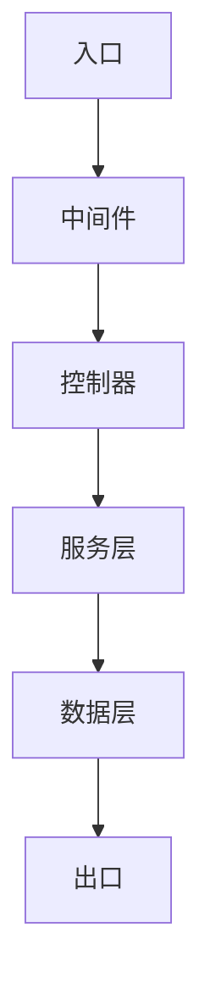
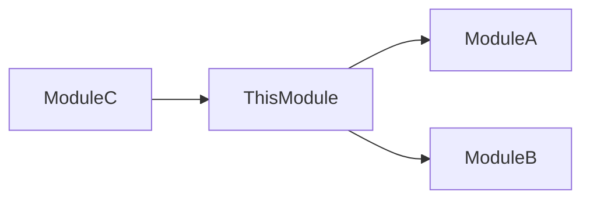

# Codebase Mode — 代码库知识化 SOP

## 适用条件

- 项目存在 manifest 文件（`package.json` / `pom.xml` / `go.mod` / `Cargo.toml` / `pyproject.toml`）
- 或存在 `src/` 目录结构
- Init 阶段 `PROJECT_TYPE` 判定为 `Codebase` 或 `Hybrid`

---

## 模块识别策略（三级）

按优先级依次执行，高优先级能确定模块边界时，低优先级作为补充验证。

### Level 1: Manifest 检测

从项目 manifest 文件中提取显式声明的模块结构：

| Manifest 文件 | 模块字段 | 示例 |
|--------------|---------|------|
| `package.json` | `workspaces` | `["packages/*", "apps/*"]` |
| `go.mod` | 顶层 module + 子目录 `go.mod` | `module github.com/org/repo` |
| `pom.xml` | `<modules>` | `<module>service-a</module>` |
| `Cargo.toml` | `[workspace] members` | `members = ["crates/*"]` |
| `pyproject.toml` | `[tool.setuptools.packages]` | `packages = ["src/*"]` |

**输出**：模块列表 + 每个模块的根目录路径

### Level 2: 目录启发式

当 Level 1 无法完全确定模块边界时，通过目录结构推断：

| 目录模式 | 推断规则 |
|---------|---------|
| `src/modules/*/` | 每个子目录 = 一个模块 |
| `packages/*/` | 每个子目录 = 一个包 |
| `apps/*/` | 每个子目录 = 一个应用 |
| `services/*/` | 每个子目录 = 一个服务 |
| `libs/*/` | 每个子目录 = 一个库 |
| `cmd/*/` (Go) | 每个子目录 = 一个可执行入口 |

**验证**：每个推断的"模块"应包含至少一个入口文件（`index.*` / `main.*` / `mod.*`）

### Level 3: LLM 辅助聚类

当 Level 1 + Level 2 仍有不确定区域时：

1. 读取项目 README（理解整体架构描述）
2. 采样每个顶级目录的 3-5 个文件
3. 根据文件内容的**职责相似性**和**导入关系**推断模块边界
4. 输出推断结果（标注为 `[inferred]`，需人工确认）

---

## 5 类必生成文章

对每个识别出的模块，生成以下 5 类文章：

### 类型 1: 模块概览

**路径**：`wiki/entities/<module-name>.md`

**模板**：

```markdown
---
created: YYYY-MM-DD
updated: YYYY-MM-DD
type: module-overview
module: <module-name>
evidence: derived
---

# <Module Name> — 模块概览

## 职责（一句话）
<!-- 这个模块做什么，用一句话概括 -->

## 边界

### 做什么
- 职责 1
- 职责 2

### 不做什么
- 不负责的事 1（由 [[other-module]] 负责）
- 不负责的事 2

## 对外接口
| 接口 | 类型 | 说明 |
|------|------|------|
| `functionName()` | 导出函数 | 一句话说明 |
| `/api/endpoint` | HTTP API | 一句话说明 |
| `EventName` | 事件 | 一句话说明 |

## 核心依赖
- [[dep-module-1]] — 依赖原因
- [[dep-module-2]] — 依赖原因
- `third-party-lib` — 用途说明
```

### 类型 2: 架构决策

**路径**：`wiki/concepts/<module-name>-adr.md`

**模板**（ADR 格式）：

```markdown
---
created: YYYY-MM-DD
updated: YYYY-MM-DD
type: architecture-decision
module: <module-name>
evidence: derived | inferred
---

# <Module Name> — 架构决策记录

## ADR-001: <决策标题>

### Context（背景）
<!-- 为什么需要做这个决策？面临什么问题？ -->

### Decision（决策）
<!-- 最终选择了什么方案？ -->

### Consequences（后果）
<!-- 正面和负面影响 -->

### 元信息
- **决策日期**：YYYY-MM-DD
- **状态**：accepted | deprecated | superseded
- **决策者**：从 git blame / PR 推断
- **替代方案**：考虑过但未采用的方案

---

## ADR-002: <下一个决策>
...
```

### 类型 3: 数据流图

**路径**：`wiki/concepts/<module-name>-dataflow.md`

**模板**：

```markdown
---
created: YYYY-MM-DD
updated: YYYY-MM-DD
type: dataflow
module: <module-name>
evidence: derived
---

# <Module Name> — 数据流图

## 主流程

### ASCII 格式
```
入口（HTTP Request / Event / CLI）
    │
    ▼
[Middleware/Guard] ── 验证/鉴权
    │
    ▼
[Controller/Handler] ── 路由分发
    │
    ▼
[Service/UseCase] ── 业务逻辑
    │
    ▼
[Repository/Client] ── 数据访问
    │
    ▼
出口（Response / Event Emit / Side Effect）
```

### Mermaid 格式


## 关键节点说明
| 节点 | 文件位置 | 职责 |
|------|---------|------|
| 中间件 | `src/middleware/auth.ts` | 身份验证 |
| 控制器 | `src/controllers/user.ts` | 请求路由 |

## 异常流
<!-- 错误处理路径 -->
```

### 类型 4: 配置地图

**路径**：`wiki/guides/<module-name>-config.md`

**模板**：

```markdown
---
created: YYYY-MM-DD
updated: YYYY-MM-DD
type: config-map
module: <module-name>
evidence: primary
---

# <Module Name> — 配置地图

## 环境变量

| 变量名 | 必需 | 默认值 | 说明 |
|--------|------|--------|------|
| `DATABASE_URL` | ✅ | — | 数据库连接字符串 |
| `PORT` | ❌ | `3000` | 服务监听端口 |
| `LOG_LEVEL` | ❌ | `info` | 日志级别 |

## 配置文件路径

| 文件 | 格式 | 用途 |
|------|------|------|
| `.env` | dotenv | 本地开发环境变量 |
| `config/default.json` | JSON | 默认配置 |
| `config/production.json` | JSON | 生产环境覆盖 |

## Secret 引用

| Secret 名称 | 管理方式 | 引用位置 |
|------------|---------|---------|
| `DB_PASSWORD` | Vault / K8s Secret | `src/config/database.ts` |
| `JWT_SECRET` | 环境变量 | `src/middleware/auth.ts` |

## 配置优先级
1. 环境变量（最高）
2. 命令行参数
3. 环境特定配置文件
4. 默认配置文件（最低）
```

### 类型 5: 依赖图谱

**路径**：`wiki/concepts/<module-name>-dependencies.md`

**模板**：

```markdown
---
created: YYYY-MM-DD
updated: YYYY-MM-DD
type: dependency-graph
module: <module-name>
evidence: primary
---

# <Module Name> — 依赖图谱

## 内部依赖（模块间调用）



| 依赖方向 | 模块 | 调用方式 | 说明 |
|---------|------|---------|------|
| → 依赖 | [[module-a]] | 直接导入 | 使用其 UserService |
| → 依赖 | [[module-b]] | 事件订阅 | 监听 OrderCreated |
| ← 被依赖 | [[module-c]] | HTTP 调用 | 提供 /api/data |

## 外部依赖（第三方服务）

| 依赖 | 版本 | 用途 | 可替代性 |
|------|------|------|---------|
| PostgreSQL | 15.x | 主数据库 | 低（深度绑定） |
| Redis | 7.x | 缓存 + 会话 | 中（可换 Memcached） |
| AWS S3 | — | 文件存储 | 高（可换 MinIO） |

## 依赖健康度
- 🟢 稳定依赖（版本锁定，无已知问题）
- 🟡 需关注（有新大版本，考虑升级）
- 🔴 风险依赖（已废弃/有安全漏洞）
```

---

## 蒸馏优先级

从代码库提取知识时，按以下优先级分配精力：

```
架构决策 > API 表面 > 横切模式 > 部署配置 >> 实现细节
```

| 优先级 | 类型 | 说明 | 投入比例 |
|--------|------|------|---------|
| P0 | 架构决策 | Why 的问题，最难从代码反推 | 30% |
| P1 | API 表面 | 对外接口/契约，使用者最关心 | 25% |
| P2 | 横切模式 | 认证/日志/错误处理等贯穿全局的模式 | 20% |
| P3 | 部署配置 | 运维需要知道的配置和依赖 | 15% |
| P4 | 实现细节 | 具体算法/数据结构（代码本身已是文档） | 10% |

**原则**：越难从代码直接读出的知识，蒸馏优先级越高。

---

## 增量更新策略

### 触发机制

通过 post-commit hook 检测变更文件列表：

```bash
# .git/hooks/post-commit 或 CI 流程中
changed_files=$(git diff --name-only HEAD~1 HEAD)
```

### 影响范围确定

知识图谱双向遍历确定受影响页面：

1. **直接影响**：变更文件对应的模块 wiki 页面
2. **间接影响**：通过 `[[wikilink]]` 关联的页面（最多遍历 2 层）
3. **判定公式**：
   ```
   affected_pages = direct_pages ∪ {p | p ∈ linked_pages(direct_pages) AND relevance(p, changes) > 0.6}
   ```

### 更新规则

- **只更新受影响页面**（不全量刷新）
- **每次最多更新 15 页**（超出则分批）
- **优先更新**：模块概览 > 数据流图 > 依赖图谱 > 配置地图 > 架构决策
- **更新粒度**：段落级（不重写整页，只更新变化的段落）

### 更新记录

```
| YYYY-MM-DD | 🔄 Codebase Update | commit abc1234 → 更新 module-a 概览 + 数据流 |
```

---

## 忽略规则

以下目录/文件在 Codebase Mode 中**始终忽略**：

```
node_modules/
.git/
build/
dist/
target/
__pycache__/
*.lock
.next/
.nuxt/
coverage/
.nyc_output/
*.min.js
*.map
vendor/ (Go)
.idea/
.vscode/
```

**忽略原则**：
- 生成产物（build/dist）→ 忽略
- 第三方代码（node_modules/vendor）→ 忽略
- 版本控制元数据（.git）→ 忽略
- IDE 配置（.idea/.vscode）→ 忽略
- Lock 文件（信息冗余，manifest 已覆盖）→ 忽略

---

## 混合策略：Wiki + Codebase RAG

### 双层架构

| 层 | 工具 | 定位 | 特点 |
|----|------|------|------|
| 架构层 | Wiki（kb/wiki/） | 稳定知识 / 深度综合 | 人工蒸馏，高质量，低频更新 |
| 代码搜索层 | Codebase RAG | 动态知识 / 精确定位 | 自动索引，实时性强，代码级 |

### 分工原则

**Wiki 负责**（稳定 + 深度）：
- 架构决策的 Why
- 模块间关系和边界
- 横切关注点的全局视角
- 最佳实践和避坑指南
- 已沉淀的经验总结

**Codebase RAG 负责**（动态 + 精确）：
- "这个函数在哪里定义的？"
- "谁调用了这个方法？"
- "这个接口的最新签名是什么？"
- 实时代码搜索和定位
- 具体实现细节

### 协作模式

```
用户提问
    │
    ├─ 架构/设计/Why 类问题 → Wiki 优先
    │
    ├─ 定位/搜索/What/Where 类问题 → RAG 优先
    │
    └─ 复合问题 → Wiki 提供上下文 + RAG 定位具体代码
```

### 同步机制

- Wiki 页面引用具体代码位置时，使用**相对路径 + 函数名**（而非行号，行号易过时）
- RAG 搜索结果与 Wiki 页面建立弱关联（通过模块名匹配）
- 每次 Codebase Update 后，检查 Wiki 中的代码引用是否仍有效
